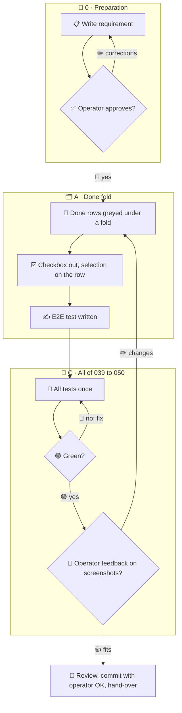

# 048 - Done Rows Greyed and Folded

## User Story

As the operator, I want finished rows in Waits on Operator clearly greyed
and out of the way, without a checkbox, so that I see at a glance what still
waits on me.

## Decisions (operator-confirmed 2026-11-25; do not re-litigate)

1. **Done** means signed and inside its undo window (`held`) or its job
   ended. Such a row is greyed (opacity at most 0.5, grayscale), carries a
   "done" pill and moves under a "Done (n)" fold at the bottom, closed by
   default. Rejected: greyed in place; hidden at once, which leaves the undo
   window only in the toast.
2. **No checkbox** (operator: the green check already does it): in Select
   mode the selection shows as the highlighted row (`aria-selected="true"`)
   and the pressed green check; `x` still selects. Rejected: keeping the
   checkbox.

## Approach

## Acceptance Criteria

### Done

- [ ] A held row and a row whose job ended lie in a closed
      `details.inbox-done` at the end of `#tasks/operator`, each with
      `data-done`, a "done" pill and a computed opacity of at most 0.5.
- [ ] Its summary reads "Done (n)" with n the number of such rows.

### Selection

- [ ] `.inbox-list .item` holds no `input[type="checkbox"]`.
- [ ] In Select mode the green check of a row sets `aria-selected="true"` on
      the row and `aria-pressed="true"` on the check; a second click clears
      both; `x` toggles the same.

### Tests

- [ ] Unit: n/a: page JS.
- [ ] Integration: the checkbox test in `test_hub_operator_tasks` becomes the
      selection check; `test_hub_grant_mode` follows.
- [ ] E2E: the Done and Selection checks at 1920 and 390; screenshots.
