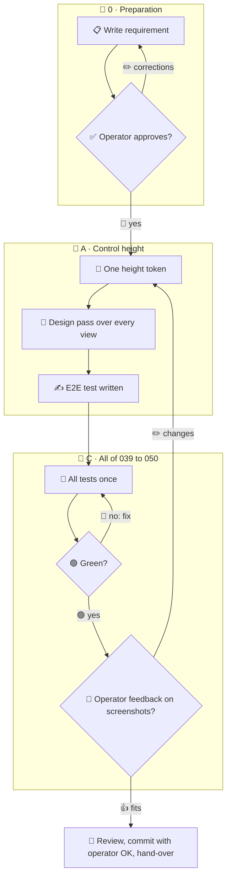

# 049 - One Control Height

## User Story

As the operator, I want every control in every head bar at one height, so
that buttons, search field and filters line up on every page.

## Decisions (operator-confirmed 2026-11-25; do not re-litigate)

1. **36 px** (operator pick) for every control in a `.box-head`: icon
   buttons, the search field with its mic, the filter button, chips and
   selects, from one CSS token. Rejected: 32 px, which shrinks the search
   field; 40 px, which grows every button.
2. **Design pass**: every view is screenshotted at 1920 and 390; each misfit
   found (alignment, wrapping, spacing) is fixed under this requirement and
   listed in the hand-over.

## Approach

## Acceptance Criteria

### Height

- [ ] `style-ui.css` defines `--control-h: 36px`, and every head-bar control
      rule uses it.
- [ ] In every view of `test_box_heads_e2e.py`, every visible control in
      `.box-head` is 36 ± 1 px high at 1920 and 390.
- [ ] Stream head: icon buttons, search field, filter button and count text
      share one vertical centre ± 1 px.

### Design pass

- [ ] The hand-over lists every misfit found with its fix and its
      before/after screenshot.

### Tests

- [ ] Unit: n/a: CSS.
- [ ] Integration: n/a: no server change.
- [ ] E2E: `test_box_heads_e2e.py` extended by the Height checks.
