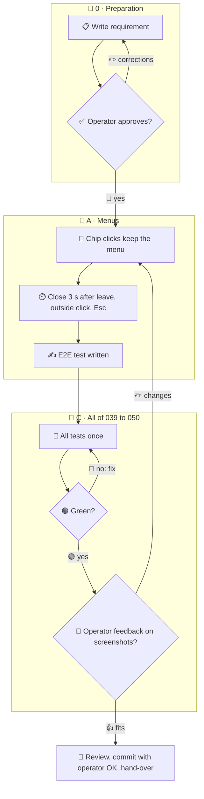

# 050 - Menus Stay Open

## User Story

As the operator, I want the filter menu to stay open while I click its
chips, so that I set several filters in one go.

## Decisions (operator-confirmed 2026-11-25; do not re-litigate)

1. **Stay open**: clicks inside the Stream filter menu, and inside every hub
   menu whose entries are toggle chips, never close it. A menu entry that
   runs an action still closes its menu.
2. **Close** (operator): 3 s after the pointer leaves the menu, cancelled when
   it comes back; at once on a click outside or Esc.

## Approach

## Acceptance Criteria

### Menu

- [ ] After clicks on three kind chips of the Stream filter menu, the menu is
      open and all three chips show their new state.
- [ ] After the pointer leaves, the menu is open at 2.5 s and closed at
      3.5 s; a return at 2 s keeps it open.
- [ ] A click outside or Esc closes it at once.

### Tests

- [ ] Unit: n/a: page JS.
- [ ] Integration: n/a: no server change.
- [ ] E2E: the Menu checks in Chromium; screenshots.
