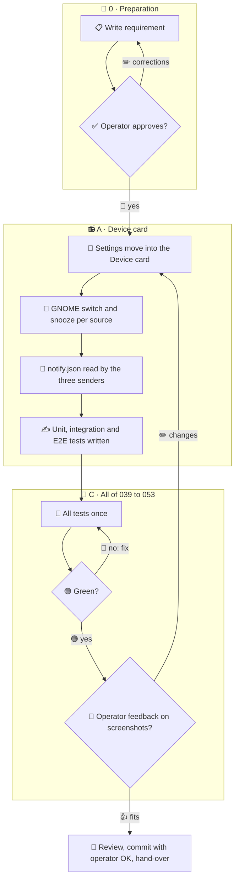

# 051 - Radio Settings in the Device Card

## User Story

As the operator, I want every notification and radio setting, including the
GNOME desktop popups, in the Device card of the radio, so that I switch how
the hub reaches me in one place.

## Decisions (operator-confirmed 2026-11-25; do not re-litigate)

1. **Device card** (operator): the notification channels, the GNOME popups
   and the internet radio stations move out of the general Settings into the
   Device card of the radio spot. The general Settings keep Ambience,
   Location, Appearance, Music and Passkey. Rejected: a card of their own; a
   gear sheet in the radio bar.
2. **GNOME popups per source** (operator picks 1 and 2): resources
   (`watch.py`), MAYDAY (`radio.py`) and the dream reminder
   (`kvb-dream/hooks/notify.sh`), each on or off and each snoozable for 1 h
   or until 8 am tomorrow. Rejected: one switch for all three, which mutes
   MAYDAY with the rest.
3. **Bridge**: every signed settings save writes `notify.json` into the
   council directory; the three senders read it before `notify-send`. A
   muted source still reaches the Stream and the radio, only the popup goes.
   A missing or unreadable file means on, so a broken file never silences an
   alarm.
4. **Signed**: the switches change through the passkey like every setting.

## Approach

## Acceptance Criteria

### Device card

- [ ] The Settings sheet has no "Notifications" and no "Internet radio"
      section.
- [ ] The Device card holds `.radio-settings` with the channel switches,
      three `.notify-source` rows (resources, mayday, dream) and the
      stations.

### Popups

- [ ] Saving resources off writes `notify.json` with
      `{"resources": {"on": false, "until": 0}, ...}` into the council
      directory.
- [ ] Snooze 1 h writes `until` = now + 3600; the source sends no popup
      before it and sends again after it.
- [ ] `watch.py`, `radio.py` and `notify.sh` run `notify-send` only for a
      source that is on and not snoozed; a missing or broken `notify.json`
      counts as on.

### Tests

- [ ] Unit: each sender with `notify.json` on, off, snoozed, expired,
      missing and broken, against a fake `notify-send`.
- [ ] Integration: a signed settings save writes `notify.json`; an unsigned
      one is refused.
- [ ] E2E: the Device card switches and snooze in Chromium; screenshots.
