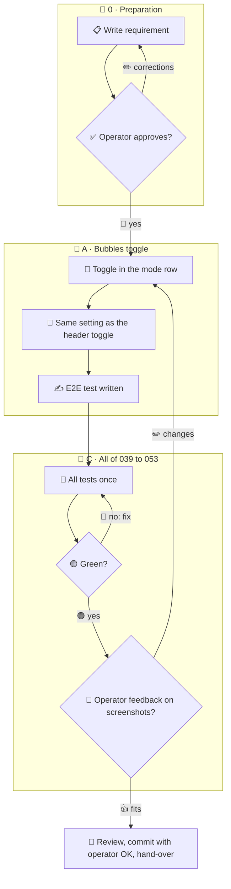

# 052 - Bubbles Beside the Modes

## User Story

As the operator, I want the chat bubbles switch beside the radio modes, so
that I set how messages reach me in one row.

## Decisions (operator-confirmed 2026-11-25; do not re-litigate)

1. **Toggle beside the modes** (operator): the bubbles switch sits in the
   mode row next to Auto, Quiet, Silence, Morse and Gibberlink, set apart as
   an on/off toggle, while the modes stay a choice of one. Rejected: a
   bubbles card in the radio spot; a bubbles spot of its own.
2. **One setting**: it switches the same `bubbles` setting as the header
   toggle, which stays as the quick switch; both always show the same state.

## Approach

## Acceptance Criteria

### Toggle

- [ ] The mode row holds a `.radio-bubbles` button with `aria-pressed`
      equal to the `bubbles` setting, separated from the mode buttons by a
      divider.
- [ ] Clicking it flips bubbles; the active mode stays the same and
      `#bubbles-toggle` shows the new state.

### Tests

- [ ] Unit: n/a: page JS.
- [ ] Integration: n/a: the setting exists.
- [ ] E2E: the Toggle checks in Chromium; screenshots.
