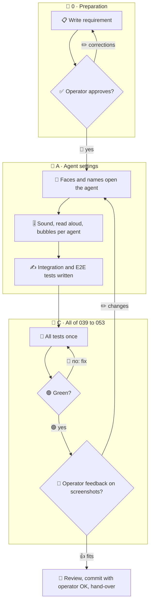

# 053 - Agent Settings on Every Face and Name

## User Story

As the operator, I want every agent's avatar and name to open that agent,
with settings of its own, so that I tune one noisy agent without touching
the rest.

## Decisions (operator-confirmed 2026-11-25; do not re-litigate)

1. **Always clickable** (operator): every agent avatar and every agent name
   in the hub opens the agent popover (`openAgent`). Today names built by
   `person()` do; avatars and names written as plain text do not.
2. **Per-agent settings** (operator): the popover gains the agent's own
   switches for sound, read aloud and bubbles, each on or off for this agent
   only, stored in the signed settings.

## Approach

## Acceptance Criteria

### Clickable

- [ ] In Stream, Waits on Operator, Match, Tasks and the radio log, every
      `.avatar[data-face]` and every agent name sits in a button that opens
      the agent popover; dragging a Match card by its head still works.

### Settings

- [ ] The agent popover holds `.agent-settings` with three switches.
- [ ] Sound off: no tone for that agent's radio; read aloud off: its
      messages are not spoken; bubbles off: no bubble for it. Other agents
      stay as they were.

### Tests

- [ ] Unit: n/a: page JS.
- [ ] Integration: the settings schema accepts the per-agent map and refuses
      unknown keys.
- [ ] E2E: the Clickable and Settings checks in Chromium; screenshots.
