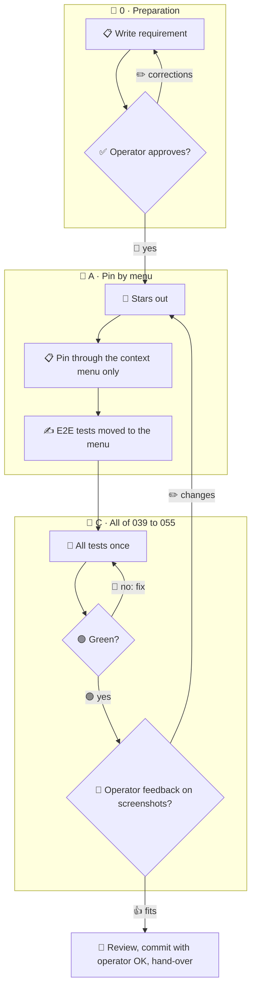

# 054 - Pin Only by Menu

## User Story

As the operator, I want no favourite stars on the boxes and pinning only
through the context menu, so that the heads stay calm and pinning still
works from everywhere.

## Decisions (operator-confirmed 2026-11-25; do not re-litigate)

1. **No stars** (operator): no `.star` button anywhere in the hub; the star
   slots and star rows go. Rejected: hiding them by CSS, which leaves them
   focusable.
2. **Menu only** (operator): "Pin to Home" and "Unpin from Home" stay in the
   context menu: right-click, a touch long press, or the menu key of the
   focused box. Existing pins stay.

## Approach

## Acceptance Criteria

### Stars

- [ ] Every view of `test_box_heads_e2e.py` and Home hold no `.star` and no
      `.star-row` element.

### Menu

- [ ] Right-clicking a box head that a star used to pin shows "Pin to Home";
      running it adds the box to Home, and the same menu then shows "Unpin
      from Home".
- [ ] A pin made before the change is still on Home.

### Tests

- [ ] Unit: the panels tests drop the star button and keep `targetOf` and
      `add`.
- [ ] Integration: n/a: no server change.
- [ ] E2E: the bookmark tests pin through the context menu; the Stars and
      Menu checks in Chromium.
