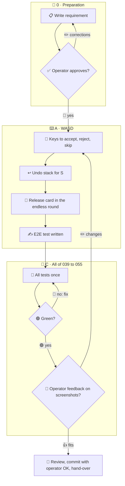

# 055 - WASD in Match

## User Story

As the operator, I want to swipe the Match deck with W, A, S and D in an
endless round with the release card coming up in between, so that I decide,
skip, undo and release without leaving the keyboard's home row.

## Decisions (operator-confirmed 2026-11-25; do not re-litigate)

1. **Keys** (operator): D accepts, A rejects, W skips to the next card, S goes
   back to the last card and undoes what happened to it: a decision is taken
   back, a skip is reversed. Each further S steps one action further back,
   down to the last release. The arrows keep working. Rejected: S undoing a
   single step only.
2. **Release card** (operator): the same keys work on the release card of
   040: D releases, A goes back to the stack, W skips on, S brings back the
   last card.
3. **Endless round** (operator): W cycles through every open card, greyed
   ones included, without end; while at least one decision waits, the
   release card is one place in that round and comes up once per lap.
4. **Precedence**: on the Match screen W, A, S and D go to the deck before
   any global key; in a text field they type as usual. The help (`?`) lists
   them.

## Approach

## Acceptance Criteria

### Keys

- [ ] D on the front card decides it as accept, A opens its reject feedback,
      W puts it at the back; the arrows still do the same.
- [ ] After D, W, D, three S bring back the cards in reverse order, the two
      decisions undone and the skipped card in front again.
- [ ] Typing W, A, S or D in a text field of the Match screen types the
      letter and moves no card.

### Round

- [ ] With one decision made and two open cards, pressing W cycles card,
      card, release card, card, and so on.
- [ ] On the release card D releases, A shows the stack, W shows the next
      card, S brings back the last card.

### Tests

- [ ] Unit: n/a: page JS.
- [ ] Integration: n/a: no server change.
- [ ] E2E: the Keys and Round checks in Chromium; screenshots.
