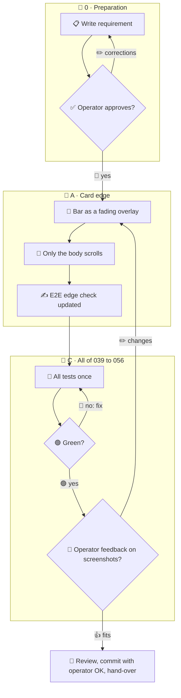

# 056 - Flowing Card Edge

## User Story

As the operator, I want the colour bar on top of a Match card to flow into
the card instead of sitting on it as a strip, so that the card reads as one
piece.

## Decisions (operator-confirmed 2026-11-25; do not re-litigate)

1. **Flowing bar** (operator, screenshot): the bar is full colour at the very
   top edge and fades into the card head within 22 px, following the card's
   rounded corners; the head's pattern fades in under it instead of starting
   at a hard line. Rejected: today's 6 px strip with a hard lower edge.
2. **No scrollbar through the edge**: the card itself no longer scrolls, only
   its body does, as 047 sets for Match cards; no scrollbar runs through the
   top corner.

## Approach

## Acceptance Criteria

### Edge

- [ ] The front card's `::before` is 22 px high, painted with the card's
      gradient and masked from opaque at 0 px to transparent at 22 px.
- [ ] The head pattern's mask starts transparent at 0 px.
- [ ] The front card computes `overflow-y: hidden`; its `.match-body`
      scrolls.

### Tests

- [ ] Unit: n/a: CSS.
- [ ] Integration: n/a: no server change.
- [ ] E2E: the edge check of `test_box_heads_e2e.py` asserts the Edge
      checks for every pattern in Chromium and Firefox; screenshots.
