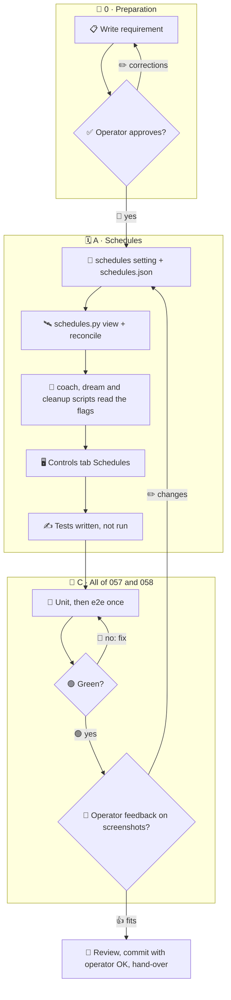

# 057 - Schedules in Controls

## User Story

As the operator, I want one list of every automatic hook and timer in
Controls, so that I switch each one off or retime it with one click and
nothing spends tokens or machine time behind my back.

## Decisions (operator-confirmed 2026-11-25; do not re-litigate)

1. **Placement** (operator): a fourth Controls tab, Schedules, right of
   Groups (`#stream/schedules`), also pinnable on Home. Rejected: a panel in
   Resources; a section of the Settings sheet.
2. **Flag file** (operator): `<council>/schedules.json` is the one store of
   the rows; the Schedules tab writes one row per change through
   `POST /api/schedules`, and `schedules.py set` writes the same file on the
   host. Every first-party hook and timer script reads it on each run. A
   missing, linked or malformed file means the defaults. Rejected: adding and
   removing hook entries in `~/.claude/settings.json` per toggle, which needs
   a passkey-signed host writer. Amended during implementation (2026-11-25):
   the first draft kept the rows in the hub settings and mirrored them to the
   file, as `notify.json`; `/kvb-coach-on` (058) runs in an agent sandbox that
   cannot reach the hub, and the next settings save would have overwritten
   its change, so the file became the store. Amended 2026-11-25 after a
   timing run: the hub keeps the store as `schedule_settings`, since a field
   `schedules` shadowed `Sources.schedules(claims, now)`, the cron rows of
   the event stream, and made every `/api/events` call fail.
3. **Rows** (operator): coach reminder (hook, every N hours, default 1, off),
   dream reminder (hook, every N hours, default 12, off), dream popup (timer,
   daily at HH:MM, default 17:00, off), queue cleanup (timer, list of HH:MM,
   default 00:00 and 12:00, on), code graph (service, on or off, on), and
   every other relevant entry found automatically: each further user timer
   and each further hook command in `~/.claude/settings.json`. The hub's own
   `kvb-orchestrator-*` units show read-only, because the hub needs them.
   A foreign row shows its schedule and next run and offers its exact off
   command to copy; the hub never switches a foreign unit.
4. **Host reconciler**: `kvb-org-organize/scripts/schedules.py`, started by
   `kvb-schedules.path` (on a change of `schedules.json`) and
   `kvb-schedules.timer` (every 5 minutes), writes
   `<council>/schedules-view.json` (timers from `systemctl --user
   list-timers --all --output=json`, hooks from `~/.claude/settings.json`)
   and applies the first-party rows: `systemctl --user enable --now` or
   `disable --now`, and a retime as the drop-in
   `~/.config/systemd/user/<timer>.d/schedule.conf` with the validated
   `OnCalendar`. Rejected: each script polling hourly, which cannot stop a
   daemon and finds no foreign timer.
5. **Dream off by default** (operator): the dream reminder and the dream
   popup start off, to save tokens; the installer copies the units and the
   reconciler enables them only when switched on.
6. **No passkey**: a schedule switches an automation, not an alarm; the
   MAYDAY and resource popups stay under 051. Residual: an agent that can
   write the council directory can switch a first-party row, as with
   `notify.json`.

## Approach

## Acceptance Criteria

### Setting and file

- [ ] `schedules.ROWS` (hub) and `schedules.py` `ROWS` (host) hold the five
      first-party rows with the defaults of decision 3; both `valid_row`
      refuse an unknown row, an hour count outside 1 to 24, a time that is
      not `HH:MM`, more than 6 cleanup times and a non-bool `on`.
- [ ] `POST /api/schedules` writes `<council>/schedules.json` with the changed
      row and every other row as stored, and needs no passkey;
      `schedules.py set` does the same on the host.

### Scripts

- [ ] The coach and dream `reminder.sh` print nothing while their row is off
      or the file is missing, and use the row's hour count while on.
- [ ] `kvb-dream/hooks/notify.sh` sends no popup while the dream popup row is
      off.

### Reconciler

- [ ] `schedules.py view` turns a fixture of `list-timers` JSON and a
      settings file into rows: name, unit file, `OnCalendar`, next and last
      run, owner `skills`, `hub` or `other`, and for hooks the event and
      command.
- [ ] `schedules.py apply` calls exactly `enable --now` or `disable --now`
      per first-party timer and service and writes the drop-in for a retime;
      it never names a foreign or `kvb-orchestrator-*` unit.
- [ ] `scripts/install.sh` installs `kvb-schedules.path` and
      `kvb-schedules.timer` and no longer enables `kvb-dream-notify.timer`.

### Controls tab

- [ ] Controls shows Tools, Rules, Groups, Schedules in that order;
      `#stream/schedules` opens it.
- [ ] Each first-party row switches on or off and retimes; the change reaches
      `schedules.json` after one click.
- [ ] Foreign and hub rows show their schedule and next run, have no switch,
      and a foreign row offers its off command to copy.
- [ ] The Schedules panel pins on Home through the context menu (054).

### Tests

- [ ] Unit: row validation on both sides; `schedules.py view` and `apply`
      against fixtures and a fake runner; both reminders and `notify.sh` with
      the flag on, off and missing.
- [ ] Integration: a `HubCase` `POST /api/schedules` writes `schedules.json`
      and the state carries the rows and the host view.
- [ ] E2E: Chromium at three widths: the tab order, a coach switch on and
      off reaching the file, a dream popup retime reaching the file, a
      foreign row without a switch, the pin on Home.
