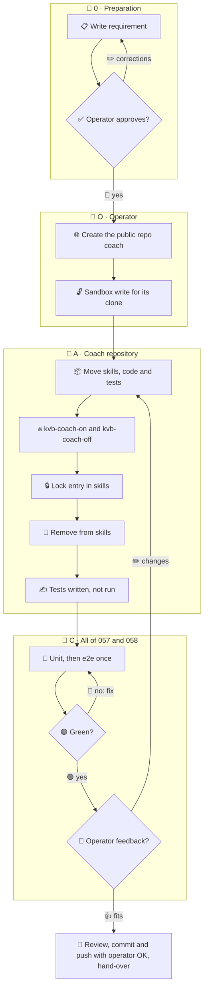

# 058 - Coach Repository

## User Story

As the operator, I want the coach in a repository of its own with commands
to switch it on and off, so that the skills repository stays lean and the
coach costs no tokens until I switch it on.

## Decisions (operator-confirmed 2026-11-25; do not re-litigate)

1. **Own repository** (operator): `github.com/kevinveenbirkenbach/coach`,
   public, cloned at `~/Repositories/github.com/kevinveenbirkenbach/coach`.
   `kvb-coach` (with `scripts/coach.py` and `hooks/reminder.sh`),
   `kvb-coach-meditation` (with `scripts/meditation.py` and
   `assets/meditation.html`) and their tests move there with their code. The
   first commit names the skills commit they came from. Rejected: a private
   repository, which needs `gh auth` on every host. Until the operator
   creates the GitHub repository the clone is built in the gitignored
   `.state/coach` of the skills repository, which the agent sandbox may
   write; the lock entries follow the push, written by `npx skills add`,
   which computes each `computedHash`.
2. **Commands** (operator): `/kvb-coach` coaches on demand as today;
   `/kvb-coach-on` switches the hourly reminder on, `/kvb-coach-off` off;
   `/kvb-coach-meditation` stays.
3. **Flag, not hook edits** (operator): on and off set the `coach` row of
   `<council>/schedules.json` (057), the same row the Schedules tab switches.
   The reminder hook stays registered and prints nothing while off. When the
   hook is missing, `/kvb-coach-on` hands the operator the install command
   instead of editing `~/.claude/settings.json`.
4. **Installed by default, off** (operator): `skills-lock.json` pins the four
   coach skills at a commit of the coach repository; the installer registers
   the reminder hook; the row starts off.
5. **Removed from skills**: `skills/kvb-coach*`, `tests/test_coach.py` and
   `tests/test_meditation.py` leave the skills repository; every reference
   in other skills, the README and the tests points to the coach repository.

## Approach

## Acceptance Criteria

### Coach repository

- [ ] The repository holds `skills/kvb-coach`, `skills/kvb-coach-on`,
      `skills/kvb-coach-off`, `skills/kvb-coach-meditation`, `tests/`, a
      README, the licence of the skills repository and a `make test` target.
- [ ] `coach.py schedule on` and `schedule off` write only the `coach` row
      of `schedules.json` and keep every other row byte for byte.
- [ ] `reminder.sh` prints nothing while the row is off or the file is
      missing.

### Skills repository

- [ ] `skills-lock.json` lists the four coach skills with `source`
      `kevinveenbirkenbach/coach` and one commit; `make install` installs
      them into `~/.claude/skills`.
- [ ] `git grep -n kvb-coach` in skills finds only the lock, the installer's
      reminder list, the README pointer to the coach repository, the
      `coach` row's hook path in `schedules.py` (057), the tests of those and
      the CHANGELOG history. Amended during implementation (2026-11-25): the
      first draft forgot the 057 row and the history.
- [ ] `skills/kvb-coach*`, `tests/test_coach.py` and `tests/test_meditation.py`
      are gone.

### Tests

- [ ] Unit (coach repository): `test_coach.py` and `test_meditation.py`
      moved; a test for `schedule on` and `off` and for the silent reminder.
- [ ] Integration: skills `test_install.py` checks the lock entries and the
      registered reminder.
- [ ] E2E: n/a: no page change beyond the Schedules row of 057.
