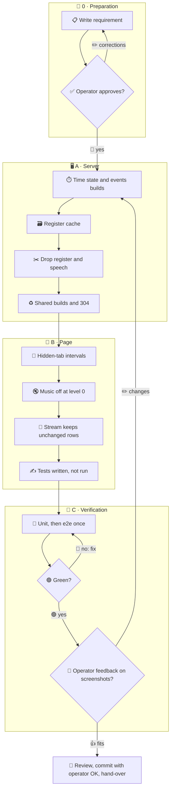

# 059 - Hub Poll Cost

## User Story

As the operator, I want the hub to rebuild and send only what changed, so
that an open page costs little CPU, memory and bandwidth.

## Decisions (operator-confirmed 2026-11-25; do not re-litigate)

1. **Register cache** (operator): `read_register` keeps the parsed
   `rasci.json` keyed by its (inode, size, mtime_ns), as `History.rows`
   does; one shared, read-only dict serves the state, the events, the rates
   and the runner's previews.
2. **Unused fields go** (operator): the state drops `register`, which no
   page module reads, and the radio rows' `speech`, which `word` and `rest`
   already carry.
3. **Cached polls** (operator): `/api/state` without `to` shares
   `live_state` by `from` rounded to the cache TTL and caches the encoded
   bytes with the dict; `/api/events` answers 304 to an `If-None-Match`
   that matches the window's digest; `drawStream` keeps its rows when the
   shown ids are unchanged. Amended 2026-11-25 in the implementation: the
   kept rows also need unchanged content and inbox items, since a review or
   decision changes its status under the same id; only the polls skip, every
   other redraw (a diff, a grant, a filter) still draws.
4. **Hidden tab** (operator): the sky, relayout and radio-sync intervals
   skip while `document.hidden` and run once on `visibilitychange`; the
   music graph stops while `musicLevel()` is 0 and restarts when it rises.
   Amended 2026-11-25 in the implementation: the radio sync keeps switching
   a playing station on its schedule in a hidden tab and skips only the
   station drawing, since a station is mostly heard with the tab in the
   background; the sky draws once on `visibilitychange` through the state
   load the event already starts.
5. **Measured**: one state build and one events build are timed before and
   after on the same council (`kvb-check-efficiency` velocity); the numbers go into the
   hand-over. The skeptic's figures were estimates from file sizes.
   Measured 2026-11-25 on a copy of the live council (3.4 MB `rasci.json`,
   185 KB `news.jsonl`), HubCase with TTL 0, median of 10 polls:
   `/api/state` 155.0 → 72.9 ms and 1,248,250 → 828,740 bytes,
   `/api/events` 65.7 → 10.7 ms at 201,454 bytes. The run also found a
   057 field shadowing the cron rows of `/api/events` (057 decision 2).

## Approach

## Acceptance Criteria

### Server

- [ ] Two `/api/state` calls on an unchanged `rasci.json` parse it once.
- [ ] The state holds no `register` key and no radio row holds `speech`.
- [ ] Two polls within the TTL share one build and one encoding.
- [ ] `/api/events` with the current ETag answers 304 without a body.

### Page

- [ ] A hidden tab draws no sky for 60 s; `visibilitychange` draws once.
- [ ] Music level 0 stops the audio graph; a rise restarts it.
- [ ] `drawStream` replaces no row when the shown ids are unchanged.

### Tests

- [ ] Unit: the parse counter, the absent fields, the ETag and fake-timer
      page probes.
- [ ] Integration: a `HubCase` state and events with and without changes.
- [ ] E2E: Chromium at three widths: Stream keeps its rows across polls,
      a hidden tab stops the sky, the music stops at level 0.
