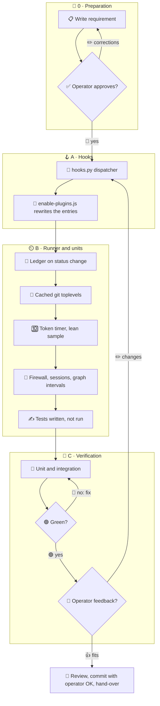

# 060 - Host Hook and Timer Load

## User Story

As the operator, I want the skills' hooks and timers to start as few
processes as they need, so that agents and the machine stay fast.

## Decisions (operator-confirmed 2026-11-25; do not re-litigate)

1. **One dispatcher** (operator): `kvb-org-organize/scripts/hooks.py
   pre-bash` and `post-bash` import radio, watch, queue, graph and log once
   and run each handler in its own `try`; the first exit 2 wins;
   `enable-plugins.js` registers it instead of the six Bash entries and
   rewrites old ones. Each handler keeps its own script for direct calls.
   Amended 2026-11-25 in the implementation: the radio block keeps its
   entry for `Edit|Write|MultiEdit|NotebookEdit` and the code graph hook its
   entry for `Read|Edit|Write|MultiEdit|NotebookEdit|Grep|Glob`, the tools
   whose input names a path; a crash counts as exit 0 so the other handlers'
   JSON answers survive.
2. **Runner ledger** (operator): a running job's output stays in memory or
   in one file per job; `jobs.json` is written on a status change only;
   finished and dismissed jobs are pruned; git toplevels are cached per
   directory until HEAD, a ref or `packed-refs` moves; the previews poll
   every 10 s, the jobs stay at 2 s.
3. **Token scan** (operator): resources `tokens` gets its own timer every
   10 minutes; `sample` stays at 60 s and starts `queue.py` only while the
   queue holds a waiting or active entry.
4. **Timers** (operator): the firewall view gets the tree heartbeat
   `ExecCondition` and writes only on a change; the sessions snapshot runs
   every 30 s and skips an unchanged write; the graph supervisor checks
   every 120 s. Amended 2026-11-25 in the implementation: the firewall also
   runs while a signed job waits; an unchanged sessions snapshot is still
   rewritten every 120 s, since the hub drops one older than five minutes.

## Approach

## Acceptance Criteria

### Hooks

- [ ] One Bash call starts one Python per hook event, counted by a fake
      interpreter; every handler's exit 2 and output stay as before.
- [ ] A crash in one handler leaves the other handlers running.

### Runner and units

- [ ] A running job with output writes `jobs.json` 0 times until it ends.
- [ ] The unit files hold the intervals and conditions of decisions 3
      and 4.
- [ ] `sample` with an empty queue starts no `queue.py`.

### Tests

- [ ] Unit: dispatcher order, exit codes and crash isolation; ledger
      writes; `sample` without a queue; the unit file pins.
- [ ] Integration: `enable-plugins.js` rewrites the six Bash entries to
      two.
- [ ] E2E: n/a: no page change.
