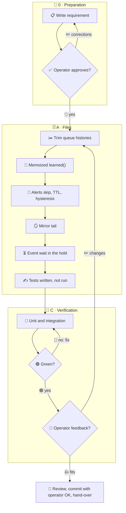

# 061 - Bounded Council Files

## User Story

As the operator, I want the council files on hot paths to stay small and be
read only when they changed, so that every prompt and Bash call stays cheap
as the weeks pass.

## Decisions (operator-confirmed 2026-11-25; do not re-litigate)

1. **Queue histories** (operator): `kvb-org-queue-cleanup` trims both queue
   histories to 30 days (`WINDOW_SECONDS`); `learned()` is memoized per
   process on both files' (mtime_ns, size). Amended 2026-11-25 in the
   implementation: the trim opens every round, before the chair check; a
   line that is no history row stays, and rows appended during the rewrite
   follow into the new file; the memo also keys on the inode and the
   config's learning keys.
2. **Alerts** (operator): the `alerts.jsonl` read is skipped while its size
   and mtime match the seen marker; rows past `ALERT_TTL` are dropped on
   append; a memory stage is entered at once and left only after 2 samples
   below it; "recovered" lines go to the chair only. Amended 2026-11-25 in
   the implementation: the marker also holds the inode; an alert row carries
   `chair`, and the disk "recovered" line is chair-only too.
3. **Mirror tail** (operator): the mirror stores the source's (inode, size)
   and appends only the grown tail; a shrunk file or a new inode takes the
   full merge. Amended 2026-11-25 in the implementation: the marker is
   `.<name>.mirrored` beside the kept copy, and the stored size ends at the
   last complete line, so a row still being written waits for the next
   mirror. Amended 2026-11-25 after `make test`: an unchanged source is
   skipped by the marker (same inode, marked size equal to its size), not
   by an equal mtime; a copy created or a row appended in the source's
   timestamp tick shared its mtime and lost those rows.
4. **Queue hold** (operator): the signal handler sets a `threading.Event`,
   and a waiting hold waits on it for `POLL_SECONDS` instead of 0.2 s
   ticks. Amended 2026-11-25 in the implementation: `Event.set()` inside a
   signal handler can deadlock when the signal lands while the main thread
   holds the event's lock in `Event.wait()`; the hold uses
   `signal.set_wakeup_fd` on a pipe and `select` for `POLL_SECONDS`
   instead, which wakes at once on a signal the same way.

## Approach

## Acceptance Criteria

- [ ] A cleanup round leaves no history row older than 30 days and keeps
      every newer row byte for byte.
- [ ] Ten prompts with an unchanged `alerts.jsonl` read it once.
- [ ] A memory value flapping around its threshold sends one alert per
      stage change, not per sample; a non-chair gets no "recovered" line.
- [ ] A grown source mirrors only its new rows; a rewritten one merges.
- [ ] A waiting hold wakes at most once per `POLL_SECONDS` without a
      signal, and at once on one.

### Tests

- [ ] Unit: trim, memo, alert skip and hysteresis, mirror tail and merge,
      event wait.
- [ ] Integration: a cleanup round on a fixture council.
- [ ] E2E: n/a: no page change.
