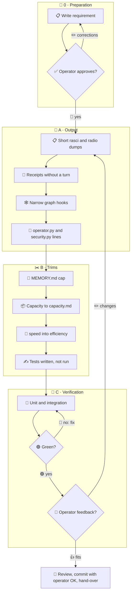

# 062 - Lean Agent Output

## User Story

As the operator, I want scripts and hooks to hand agents only what they
use, so that sessions spend fewer tokens and fewer turns.

## Decisions (operator-confirmed 2026-11-25; do not re-litigate)

1. **Short dumps** (operator): `rasci.py show` lists the top 30 by rank
   plus "N more (show --all)", and the rasci skill summarizes instead of
   reprinting; `radio.py show --since <duration> --summary` prints the
   counts per class and peer and the last row of each; `kvb-org-matrix`
   and the radio hint use it. Amended 2026-11-25 in the implementation: the
   table keeps its two head lines and the gaps line, which names the shown
   rows only, so 30 rows print at most 34 lines, 33 without a gap; the
   radio hint reads `radio.py show --all --since 1d --summary`.
2. **Quieter hooks and tools** (operator): call receipts alone never exit 2
   and ride the next context as "read by X HH:MM" without the text;
   `enable-plugins.js` narrows the codebase-memory-mcp PreToolUse matcher to
   `Grep|Glob` and drops its PostToolUse `Read` entry after the install;
   `operator.py list` shows each command once and `add` dedupes by
   directory and command; `security.py` prints `critical <n>` by default and
   the skill drops `--json`. Amended 2026-11-25 in the implementation:
   - Receipts alone wait at the Stop hook and ride the next prompt hook as
     `MAIL CALL read by X HH:MM (your call of HH:MM)`; with a letter pending
     the Stop mailbox takes them along, oldest first.
   - `scripts/graph-hooks.js` narrows the graph hooks in
     `~/.claude/settings.json` right after the codebase-memory-mcp installer
     in `install.sh`: `enable-plugins.js` runs earlier and writes
     `settings.local.json`, which never holds the installer's hooks. It also
     drops the duplicate entries every reinstall adds; an entry mixing the
     graph binary with another hook stays as it is.
   - A second `add` of an open command in the same directory by another
     session joins that row as one more A and keeps its session; the same
     session may record one command for two steps on purpose, as the
     existing operator tests do. `list` prints `step N` in the table and the
     command once in its bash block.
   - The line reads `🛡️ security <n> % critical <c> (medusa: ...)`.
3. **Trims** (operator): `budget.py` fails a `MEMORY.md` over 400 words; the
   Capacity section of `kvb-org-organize` moves to `capacity.md`;
   `kvb-check-speed` folds into `kvb-check-efficiency`; `kvb-skill-silence`
   names the compact window `enable-plugins.js` writes (300000). Amended
   2026-11-25 in the implementation: `budget.py --memory <path>` takes the
   index, repeatable, a missing file counting as empty; `kvb-org-organize`
   keeps a two-line Capacity pointer to `capacity.md`, and its schedules
   moved into their own `## Schedules` section.

## Approach

## Acceptance Criteria

- [ ] `rasci.py show` on 600 open rows without gaps prints at most 33
      lines, the last `570 more (show --all)`.
- [ ] `radio.py show --summary` prints one line per class and peer.
- [ ] A batch of receipts alone exits 0 and prints nothing.
- [ ] After the install the graph hooks match `Grep|Glob` only and no
      `Read` entry is left.
- [ ] `operator.py list` prints each command once; `add` twice keeps one
      row.
- [ ] The default `security.py` output names the critical count in one
      line.
- [ ] `budget.py` exits 1 on a 401-word `MEMORY.md`; `kvb-check-speed` is
      gone and every reference points to `kvb-check-efficiency`.

### Tests

- [ ] Unit: each script output above; the `budget.py` memory cap.
- [ ] Integration: `graph-hooks.js` on a settings fixture with the graph
      hooks (`tests/test_lean_output.py`); the naming test without
      `kvb-check-speed`.
- [ ] E2E: n/a: no page change.
