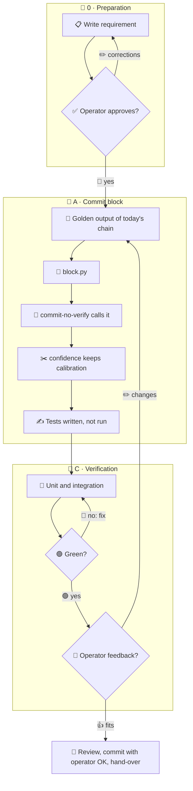

# 063 - One Commit Block

## User Story

As the operator, I want one script to build a commit's score table and
message block, so that a commit loads three skills instead of eleven.

## Decisions (operator-confirmed 2026-11-25; do not re-litigate)

1. **One script** (operator): `kvb-check-score/scripts/block.py --repo
   <tree> --fix <n> --break <n>` runs `tokens.py`, `measure.py`, the speed
   check, `security.py` (the critical count) and `gate.py status`, then
   prints the commit table and the `--message-block` paragraph; its exit
   codes are `score.py`'s (4 critical, 1 below 90/5, 3 ask again, 0 pass).
   Amended 2026-11-25 in the implementation:
   - `--base <ref>` is required as for every script it runs; `tokens.py`
     runs on `--transcripts <dir>` (skill text changed, with `--saves` and
     `--evidence` passed on as its `--value`), `measure.py` on
     `-- <command...>` (runnable code changed), the higher tokens figure
     counting when both ran; without either, tokens and velocity are `-`.
     The speed check is `measure.py`'s velocity since 062 folded
     `kvb-check-speed` into `kvb-check-efficiency`.
   - Figures are read by their shape (`<n> %`, `new`, `<n> % critical <c>`,
     `value <n:n>`), never by a label, so `labels.json` stays the one place
     for labels.
   - The output adds the `gate.py status` verdict between table and block,
     and an `after the commit:` line with the `score.py --commit-table
     --commit <hash>` call, so the table after the commit reuses the
     measured figures instead of measuring again.
   - A script that exits outside its result codes or prints no figure
     stops the run with exit 2 and `block: <script> exited <code>: <last
     line>` before anything is printed.
2. **Shorter chain**: `kvb-git-commit-no-verify` calls `block.py`;
   `kvb-check-confidence` keeps the calibration rules; the score,
   efficiency and security skills keep their scripts for direct use.
   Amended 2026-11-25 in the implementation: `kvb-git-commit-next` and
   `kvb-check-confidence` point to step 2 of `kvb-git-commit-no-verify`
   instead of restating the chain, and `kvb-check-score` names `block.py`
   in one sentence. The three skills count the scoring chain; the clean,
   legal and hub-approval passes of step 1 and 3 stay their own concerns.
3. **Judgement stays**: fix confidence and break risk stay the agent's
   inputs (`kvb-check-break-risk`); `block.py` never estimates them.

## Approach

## Acceptance Criteria

- [ ] `block.py` on a fixture repository prints the same table and block as
      today's chain of single scripts (golden test).
- [ ] Its exit codes match `score.py`'s for a critical finding, a 90/5
      miss, an over-budget ask and a pass.
- [ ] The commit path names `block.py` and loads at most three SKILL.md
      files: commit-no-verify, confidence and break-risk.

### Tests

- [ ] Unit: the golden output, the exit codes, a failing sub-script named
      (`tests/test_block.py`).
- [ ] Integration: `block.py` with fake tokens, measure, security and gate
      scripts beside the real `score.py`.
- [ ] E2E: n/a: no page change.
