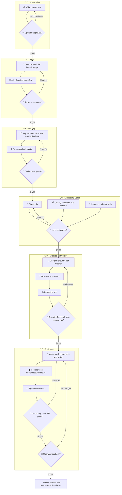

# 064 - Code Review

## User Story

As the operator, I want one skill that reviews a change against every
standard of its repository and every check Quality offers before a push, so
that no commit reaches a remote that a deep review would have stopped.

## Decisions (operator-confirmed 2026-11-26; do not re-litigate)

1. **Two skills, one owner each** (operator): `kvb-code-review` in this
   repository is the wrapper and manager (target, standards, harness skills,
   skeptics, memory, stamp, hook, waiver); `kvb-quality-review` in the
   quality repository is the base that runs every quality check, written
   and built by Quality as the eighth skill of quality 003 (amending its
   decision 1: security, legal, architecture, score, confidence,
   break-risk, performance, review), which also holds the call contract
   (`--base`, `--staged`, `--range`, `--all`, repeatable `--path`; exit 0
   clean, 1 findings, 2 usage or tool error; findings with lens, rule,
   severity, path, line, commit, tier and the file's blob hash; a version
   per lens; the performance lens runs only with `--measure` and fills the
   efficiency and speed scores of `kvb-quality-score`; break risk and
   confidence left to this skill). Rejected: the review in Quality (Quality analyses,
   the review orchestrates and gates pushes); `kvb-check-review` (the check
   category empties once quality 003 moves the scanners); `kvb-review`
   without category.
2. **Target first** (operator): the skill first asks what to review: the
   branch against the default branch (`main` or `master`), a commit range,
   the staged changes, or a pull request; the detected target is the
   recommended option: staged changes present → staged; an open pull
   request for the branch → that pull request; commits ahead of the default
   branch → the branch; else the range the operator names.
3. **Repository standards**: `AGENTS.md`, `CONTRIBUTING.md`, every file
   under `docs/contributing/` and the `AGENTS.md` of every
   `roles/<role>/` the diff touches; a standards finding cites the rule's
   `file:line`.
4. **Everything Quality offers** (operator): one call to
   `kvb-quality-review` once a quality tag carries it (quality 003), with
   `--db` when a `quality db update` bundle exists (else its deep tier is
   listed as skipped) and `--measure` when the change touches runnable
   code (the performance lens: CPU, RAM and wall clock). Until then
   (operator: build now, switch later) `quality check` (`--base <ref>` or
   `--staged`; `.qualityignore.yml` and folder `.nocheck` are honoured by
   Quality itself) and the analysis skills of today: `kvb-check-security`,
   `kvb-check-legal`, `kvb-check-principles`, `kvb-check-break-risk`,
   `kvb-check-confidence`, `kvb-check-score`, `kvb-check-efficiency`
   (its `measure.py`, the later performance lens, only with runnable
   code). A lens
   that cannot run is listed with its reason, never dropped.
5. **Harness review skills** (operator): every read-only review skill the
   harness lists runs as a further lens (Claude Code today: `/code-review`
   as the correctness lens, `/security-review`); a harness that lists none
   gets only the own lenses. Rejected: fix-applying skills (`/simplify`,
   `--fix`), because the review never edits.
6. **Skeptics** (operator): one skeptic per lens checks all its findings in
   one pass; every critical or high finding gets its own extra skeptic
   before it may block. A refuted finding stays in the table as refuted.
   Rejected: one skeptic per finding (cost grows per finding); skeptics for
   blockers only (medium and low unverified).
7. **Clean** (operator): a review is clean when no confirmed finding is
   critical or high. Rejected: every confirmed finding blocks; only
   critical blocks.
8. **Stamp** (operator, P1): `review.py stamp` records the verdict for
   `HEAD^{tree}` in `kvb-review.json` in the git common dir, only when the
   review's target is everything the push sends (upstream..HEAD, the
   default branch without an upstream) and the tracked tree is clean. A new
   tree voids it; a signing-only rewrite keeps it. `kvb-git-push` hands a
   push row only when `gate.py status` is green and `review.py status` is
   clean or waived for the same tree.
9. **Hook** (operator, P3): a pre-bash handler in
   `kvb-org-organize/scripts/hooks.py` refuses `operator.py add` with
   `--check pushed:<dir>` while `<dir>`'s `HEAD^{tree}` has neither a clean
   stamp nor a waiver.
10. **Waiver** (operator): per push, through a hub decision card ("Waive
    the review for the push of tree `<hash>` in `<dir>`?"); `review.py
    waive` records the signed answer once `operator_message` returns
    `match`, and the hook verifies it again through the hub's
    `operator_message`; an unreachable hub refuses. Rejected: the operator
    pushing by hand; a typed waiver flag (any agent can type it).
11. **Output**: one table ranked by severity, `| Severity | Lens | File:line
    | Finding | Skeptic | Evidence |`, then the commit score block of
    `block.py` (063; `kvb-git-commit-no-verify` after 022 decision 10),
    its break risk and confidence
    judged by this skill.
12. **Read-only**: the review never edits, stages, commits or pushes. The
    CI review of pushes and pull requests with inline comments is its own
    requirement, after this one.
13. **Memory** (operator): what was reviewed is not reviewed again. Results
    live in `kvb-review-cache.json` in the git common dir, keyed by lens,
    lens version, path, the file's blob hash and the digest of the
    standards files it was judged against; skeptic verdicts are keyed by
    the finding (lens, rule, path, blob hash, the flagged line's text). A
    lens reruns only on files whose key changed; a lens that judges the
    whole diff reruns only when the diff's `git patch-id` changed.
14. **Tokens and velocity** (operator): lenses run in parallel, scripts as
    processes and judging lenses as subagents, heavy runs through
    `queue.py hold`, light runs self-admitted (`kvb-org-organize`
    Capacity); the skeptics of different lenses run in parallel. A
    subagent gets only its files' hunks and the cited standard sections,
    never whole documents, on the model `kvb-org-perform` picks, and
    answers in the table's columns.

## Approach

## Acceptance Criteria

### Target

- [ ] `review.py target --repo <root>` prints `staged` for a fixture with
      staged changes, `pr <n>` with an open pull request (`gh` stubbed),
      `branch <default>` for commits ahead of `main` or `master`, else
      `range`.
- [ ] The skill's first question lists the four targets with the detected
      one first and marked recommended (`SKILL.md` text and a test on it).

### Lenses

- [ ] The standards lens reads `AGENTS.md`, `CONTRIBUTING.md`, every file
      under `docs/contributing/` and `roles/<role>/AGENTS.md` for each
      touched role, and names each file it read in the output.
- [ ] `quality check --base <ref>` runs for a branch, pull request or range
      target, `--staged` for a staged one; a finding Quality waives in
      `.qualityignore.yml` or `.nocheck` does not appear.
- [ ] Each of the seven `kvb-check-*` lenses runs or appears under
      `skipped` with its reason; none is silently absent.
- [ ] With `/code-review` and `/security-review` listed by the harness both
      run; with none listed the output says `harness: none` and the own
      lenses still run.

### Memory

- [ ] A second review of an unchanged tree starts no lens and no skeptic
      and prints every row from `kvb-review-cache.json`.
- [ ] Changing one file reruns the per-file lenses on that file only;
      a whole-diff lens reruns because the `git patch-id` changed.
- [ ] Changing a standards file reruns the standards lens on every file.
- [ ] A cached skeptic verdict is reused for the same finding key and never
      for a changed flagged line.

### Tokens and velocity

- [ ] The lenses of one review start in parallel; the run's log shows their
      start times within one second of each other, heavy ones as
      `queue.py hold` jobs.
- [ ] A subagent brief holds only its files' hunks and the cited standard
      sections; a test asserts no whole `AGENTS.md` or `CONTRIBUTING.md` is
      in a brief.
- [ ] A re-review of an unchanged tree finishes in under 5 s wall clock.

### Verdict and stamp

- [ ] A confirmed high finding gives `verdict: blocked`; only medium and
      low confirmed gives `verdict: clean`.
- [ ] `review.py stamp` refuses with exit 2 when the tracked tree is dirty
      or the target is not upstream..HEAD.
- [ ] `review.py status --repo <root>` prints `review: clean`, `blocked`,
      `waived` or `missing` for `HEAD^{tree}`; a new commit gives
      `missing`; a signing-only rewrite keeps `clean`.

### Push gate

- [ ] `kvb-git-push` hands no push row while `review.py status` is not
      `clean` or `waived` (`SKILL.md` step and a test).
- [ ] The hook refuses `operator.py add ... --check pushed:<dir>` with
      exit 2 and the reason `no clean review for tree <hash>`; with a clean
      stamp it allows; other `operator.py add` rows pass untouched.
- [ ] A waiver whose signed answer `operator_message` does not match, or an
      unreachable hub, keeps the row refused.

### Tests

- Unit:
  - [ ] Target detection, cache keys, stamp, status and waiver in
        `tests/test_code_review.py`.
  - [ ] The hook handler in `tests/test_hooks.py`.
- Integration:
  - [ ] `operator.py add --check pushed:` through `hooks.py pre-bash` on a
        fixture repository: refused without a stamp, allowed with a clean
        one, allowed with a verified waiver.
  - [ ] A run on a fixture with a planted high finding ends `blocked`; the
        same run again starts no lens.
- E2E:
  - [ ] Hub e2e: the waiver decision card is signed with the virtual
        passkey, `review.py waive` records it and the hook then allows the
        row.
