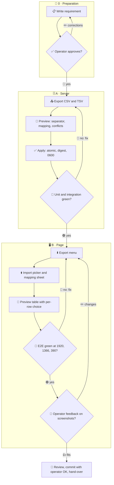

# 065 - Accounts Spreadsheet Round Trip

## User Story

As the operator, I want to export the Accounts table as CSV or TSV and import
such a file with a column mapping, so that I can keep and edit my accounts in
a spreadsheet and bring them back without typing each one into the hub.

## Decisions (operator-confirmed 2026-11-26; do not re-litigate)

1. **Export holds the stored fields only** (operator): header
   `provider,email,renewal_day,renewal_time,reset_day,reset_time,resubscribe,autorenew,limit,note`,
   days `Sun` to `Sat`, autorenew `yes`/`no`, an empty limit for none; an
   exported file imports again with every row unchanged. Rejected: usage
   columns (a snapshot the import cannot take back); a column picker (more
   UI, no round trip gain).
2. **Formats**: CSV (comma, RFC 4180 quoting) and TSV, both UTF-8; the file
   is named `accounts-<YYYY-MM-DD>.csv` or `.tsv`.
3. **Server side** (operator): `GET /api/accounts/export?format=csv|tsv`
   answers the file as an attachment with `Cache-Control: no-store`;
   `POST /api/accounts/import/preview` and `POST /api/accounts/import/apply`
   take the file's text, separator, mapping and conflict choices as JSON.
   Python's `csv` module reads and writes; every row passes
   `valid_account()`. On export a cell starting with `=`, `+`, `-`, `@`, tab
   or carriage return gets a leading `'` (formula injection); the import
   strips exactly that prefix. Rejected: parsing in the browser (a second
   CSV parser and a second validation).
4. **Mapping** (operator): the preview detects the separator (comma,
   semicolon, tab; the request may override it) and proposes for each field
   the column whose header equals the field name or the table's label,
   ignoring case; each field has a dropdown over the file's columns plus
   "not in file". Renewal and reset take one column (`Mon 09:00`) or two
   (day, time); weekdays as 0 to 6 (0 Sunday), English or German names and
   their short forms; autorenew as yes/no, true/false, 1/0, ja/nein.
   Required: provider, email, renewal, reset; a missing optional field takes
   its empty value (resubscribe "", autorenew no, limit none, note "").
5. **Conflicts** (operator): a row whose email exists updates that account
   by default; the preview offers per conflicting row `overwrite` or `keep`
   and one switch for all rows; accounts not in the file stay. Rejected:
   replacing all accounts (deletes by accident); adding new ones only (no
   way to update).
6. **Preview, then apply**: the preview marks every row `new`, `update`
   (with its changed fields and its choice), `unchanged` or `error` (with the
   validator's message); a duplicate email inside the file is an error on
   both rows. Apply is offered only at zero errors, re-validates on the
   server, writes all rows in one ledger write or none, and answers 409 when
   the ledger changed since the preview (digest in the preview).
7. **Limits**: at most 256 KiB and 500 rows per file; text that is not UTF-8
   is refused; a leading byte order mark is dropped.
8. **Host only** (028 decision 1 stays): the export leaves the hub only as
   the download the operator starts; the hub writes no export file, stores
   no import file and logs no cell value; fixtures use example.org.
9. **Place**: two icon buttons in the Accounts head left of `+`: Export
   (`bi-download`, menu CSV and TSV) and Import (`bi-upload`, file picker,
   then a mapping sheet like the account sheet).

## Approach

## Acceptance Criteria

### Export

- [ ] `GET /api/accounts/export?format=csv` on a fixture with two accounts
      answers 200, `text/csv; charset=utf-8`, `Content-Disposition:
      attachment; filename="accounts-<date>.csv"`, `Cache-Control: no-store`,
      the header of decision 1 and one line per account; `format=tsv` the
      same with tabs and `text/tab-separated-values`; any other format 400.
- [ ] A note `=HYPERLINK("x")` exports as `'=HYPERLINK("x")` and imports back
      as `=HYPERLINK("x")`.
- [ ] Exporting the fixture and previewing that file gives every row
      `unchanged`.
- [ ] The hub's state dir lists the same files before and after an export.

### Mapping

- [ ] Headers `Provider,Email,Renewal,Next reset` (the table's labels) map
      without any choice; unknown headers map nothing and the preview names
      provider, email, renewal and reset as missing.
- [ ] Comma, semicolon and tab fixtures are each detected; a separator in
      the request wins over the detection.
- [ ] `0`, `Sun`, `Sunday`, `So` and `Sonntag` all give day 0; `Mon 09:00`
      in one column equals `Mon` and `09:00` in two; `7` and `Funday` are row
      errors naming the column.
- [ ] Without optional columns a row gets resubscribe "", autorenew false,
      limit null and note "".
- [ ] A file over 256 KiB or 500 rows, or not UTF-8, answers 400 and parses
      nothing.

### Conflicts

- [ ] Ledger `a@example.org`, file with `a@example.org` changed and
      `b@example.org`: preview shows a as `update` with its changed fields
      and choice `overwrite`, b as `new`.
- [ ] Apply with `keep` for a leaves a unchanged and adds b; with
      `overwrite` it replaces a's fields and keeps a's id.
- [ ] An account missing from the file still exists after apply.
- [ ] Two rows with one email are both `error`.

### Apply

- [ ] Apply with an error row answers 400 and leaves `accounts.json`
      byte-identical.
- [ ] Apply after the ledger changed since the preview answers 409 and
      changes nothing.
- [ ] After apply `accounts.json` keeps mode 0600.

### Page

- [ ] The Export menu's CSV and TSV items are links to
      `/api/accounts/export?format=csv` and `?format=tsv` with a `download`
      attribute.
- [ ] Picking a fixture file opens the mapping sheet with one preselected
      dropdown per field, the separator select and the preview table;
      changing a dropdown re-runs the preview; Apply is disabled while an
      error row exists; after apply the table shows the imported rows.

### Tests

- Unit:
  - [ ] `tests/test_hub_accounts_io.py`: export bytes, injection prefix
        round trip, separator detection, header matching, weekday and time
        parsing, empty values, conflict classes, duplicate emails, limits,
        ledger digest.
- Integration:
  - [ ] Export, preview and apply through the HTTP handler on a temporary
        state dir: status codes, headers, file mode, atomic write, 409.
- E2E:
  - [ ] `tests/e2e/test_resources_accounts_e2e.py`: export links, import
        with one dropdown changed, `keep` on one conflict, apply,
        screenshots at 1920, 1366 and 390.
