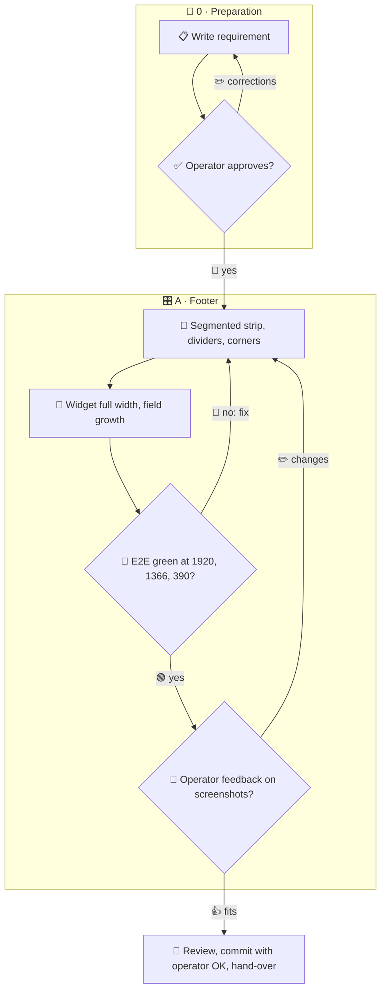

# 066 - Radio Composer Footer

## User Story

As the operator, I want the radio composer's buttons in one calm, flush footer
strip, so that panel and widget look harmonious and the widget uses its whole
width.

## Decisions (operator-confirmed 2026-11-27; do not re-litigate)

1. **Segmented footer** (operator): the bottom row is one strip flush with the
   composer's bottom edge: Record │ mic │ PTT │ ▾ │ MAYDAY, cells separated
   only by 1 px vertical dividers, one height, Record taking the bottom-left
   corner radius, MAYDAY the bottom-right. Rejected: controls inside the field
   (MAYDAY less visible); two joined pill groups (still separate pills).
2. **Flowing transitions**: hover, active and focus change only background and
   colour over 150 ms; no border, size or shadow jumps; recording pulses the
   Record dot.
3. **Text field**: grows with its text up to 6 lines, then scrolls; no native
   resize handle or spin arrows.
4. **Widget full width** (operator): in widget mode the composer has no inner
   margin or second card frame; its edges are the widget's edges.
5. **One component**: the Speak panel and the widget render the same footer;
   below 480 px width the cell labels collapse to icons and nothing wraps.

## Approach

## Acceptance Criteria

### Footer

- [ ] The five cells' bounding boxes share top and bottom (±1 px) and touch
      with gap 0, in panel and widget.
- [ ] The Record cell's bottom-left and the MAYDAY cell's bottom-right radius
      equal the composer's radius.
- [ ] Between neighbouring cells exactly one 1 px divider shows; no cell has
      its own outer border.
- [ ] Every cell's `transition` covers `background-color` and `color` at
      150 ms, and no `border-width`, `padding` or `box-shadow` changes on
      hover or focus.

### Field and widget

- [ ] Typing 3 lines grows the field without a scrollbar; 8 lines show a
      scrollbar at 6 lines' height; `resize` is `none`.
- [ ] In widget mode the composer's width equals the widget body's width
      (±1 px).
- [ ] At 390 px the labels are hidden, the icons stay, and the footer is one
      line.

### Tests

- Unit: n/a: layout only, no logic.
- Integration: n/a: no server change.
- E2E:
  - [ ] `tests/e2e/test_radio_composer_e2e.py`: the geometry checks above in
        panel and widget, screenshots at 1920, 1366 and 390.
