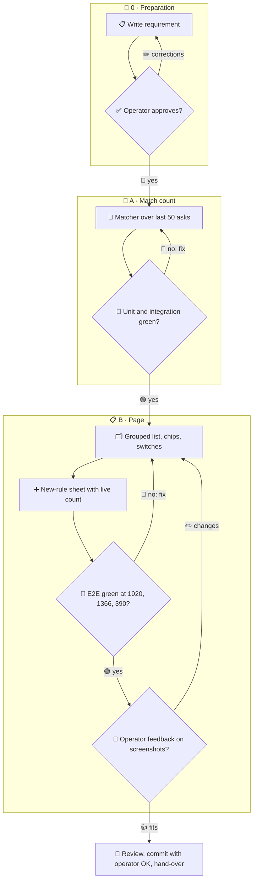

# 067 - Rules Page Overview

## User Story

As the operator, I want the rules page to show my rules as a clear list with
how often each one would have matched, so that I see at a glance what is
granted automatically.

## Decisions (operator-confirmed 2026-11-27; do not re-litigate)

1. **List first** (operator): the rules are grouped Ask, Review and Decision,
   collapsible, with counts in the headers. Each row holds: on switch, tool
   (Ask), pattern, directory, applies-to, an expiry chip (days left, red under
   2 days), match count, delete. Rejected: tabs per kind (hides the
   overview); only reordering (stays cluttered).
2. **New rule in a sheet**: a "+ New rule" button opens the existing form in a
   sheet; the signing flow is unchanged.
3. **Match count** (operator): each rule shows "N of the last 50 asks"; the
   sheet shows the live count for the draft while typing. The hub computes it
   with its existing rule matcher over the last 50 ask records; it is
   read-only and grants nothing.
4. **Firewall below**: settings, patterns, groups and sets stay, as sections
   collapsed by default under the list.

## Approach

## Acceptance Criteria

### Match count

- [ ] `POST /api/rules/match` with a draft rule answers `{matched, of}`, with
      `of` at most 50, counting the last asks the matcher would grant; a bad
      draft answers 400.
- [ ] Every stored rule in the rules payload carries `matched`; a fixture
      with 3 matching asks of 5 shows 3.
- [ ] The match call writes nothing (the state dir lists the same files
      before and after).

### Page

- [ ] The page shows three group headers with their counts; collapsing one
      hides its rows.
- [ ] A row shows switch, pattern, expiry chip and match count; a rule
      expiring tomorrow has the red chip.
- [ ] "+ New rule" opens a sheet; changing the pattern updates the live
      count; creating it adds the row without a reload.
- [ ] Firewall sections are collapsed when the page opens.

### Tests

- Unit:
  - [ ] The matcher count over a fixture of asks in
        `tests/test_hub_rules_match.py`.
- Integration:
  - [ ] `/api/rules/match` and `matched` in the payload through the HTTP
        handler.
- E2E:
  - [ ] `tests/e2e/test_rules_page_e2e.py`: groups, chip, sheet with live
        count, screenshots at 1920, 1366 and 390.
