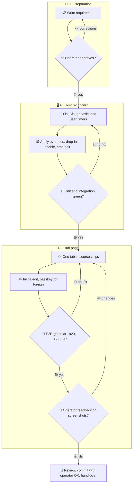

# 068 - Schedules Editor

## User Story

As the operator, I want every timer and cron on my host listed in one simple
table that I can edit in place, so that I switch off or retime anything
without a terminal.

## Decisions (operator-confirmed 2026-11-27; do not re-litigate)

1. **One table, all sources** (operator): Skills (the first-party rows), Hub
   (`kvb-orchestrator-*`), Claude (durable tasks in each project's
   `.claude/scheduled_tasks.json` under the host's repositories) and System
   (other `systemctl --user` timers). Columns: Source, Name, Schedule, Next,
   Last, On. One filter chip per source. Root timers are out of scope (no root
   on the host).
2. **Edits through the host reconciler** (operator): the page writes the
   desired state to `schedules.json`, and the existing reconciler applies it:
   a systemd drop-in `schedule.conf` plus enable or disable for timers, an
   edited or removed entry for Claude tasks. Rejected: each edit as a runner
   row (slower); system timers read-only (less function).
3. **Passkey for foreign rows** (operator): changing a System row or a Claude
   task needs a passkey signature; Skills and Hub rows need none.
4. **Schedule input**: timers take daily times (`17:00, 21:30`) or a raw
   `OnCalendar` expression, which the reconciler validates with
   `systemd-analyze calendar` and reports invalid ones as a row error. Claude
   tasks take a 5-field cron, validated by the hub.
5. **Never destructive**: the hub never deletes a unit file; "Reset" removes
   only its drop-in.
6. **Simpler**: one table, inline edit on click, hints only in tooltips; the
   reconciler's last run shows once in the header.

## Approach

## Acceptance Criteria

### Reconciler

- [ ] On a fixture host the view lists rows of all four sources with
      `source`, `schedule`, `next`, `last` and `on`.
- [ ] An override with times for a System timer writes
      `<unit>.d/schedule.conf` and calls `daemon-reload`; "Reset" removes the
      file.
- [ ] An invalid `OnCalendar` keeps the old schedule and shows the row's
      error.
- [ ] A Claude task override changes its cron in `scheduled_tasks.json` and
      keeps every other key byte for byte.

### Hub

- [ ] Saving a System or Claude row without a valid passkey proof answers 403
      and stores nothing; with one, 200.
- [ ] A Skills row saves without a proof.
- [ ] A bad cron answers 400 naming the field.

### Page

- [ ] The source chips filter the table; clicking a schedule cell turns it
      into a field, and Enter saves.
- [ ] A foreign row's save opens the passkey prompt.

### Tests

- Unit:
  - [ ] Reconciler listing and override application on fixture files in
        `tests/test_schedules.py`.
- Integration:
  - [ ] `/api/schedules` overrides with and without a proof through the
        handler.
- E2E:
  - [ ] `tests/e2e/test_schedules_e2e.py`: chips, inline edit, the passkey
        prompt for a foreign row (virtual authenticator), screenshots at
        1920, 1366 and 390.
