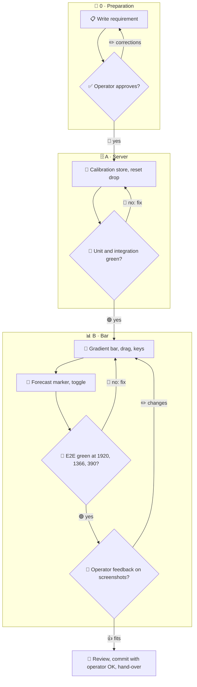

# 069 - Account Usage Bar

## User Story

As the operator, I want a usage bar per account that I can correct by
dragging and that resets itself on the reset date, so that I see how much of
each plan is left.

## Decisions (operator-confirmed 2026-11-27; do not re-litigate)

1. **Bar per account** (operator): fill = tokens used since the last reset
   divided by the limit; an account without a limit shows no bar, only its
   count.
2. **Calibrate by drag** (operator): dragging the handle sets the share to
   what the provider shows. The hub stores `{share, at}` per account id in
   `account-calibration.json` (state dir, mode 0600), and the bar shows
   calibration plus the tokens counted since `at`. Keyboard: arrows move 1 %,
   PageUp and PageDown 10 %. Rejected: manual only (loses the count).
3. **Auto reset**: at the account's reset moment the calibration is dropped
   and the count starts at zero.
4. **Flowing colour** (operator): the fill colour follows the share
   continuously: 0 % green, 50 % yellow, 75 % orange, 100 % red, interpolated
   in OKLCH without steps.
5. **Forecast switchable** (operator): an "Auto forecast" toggle in the
   Accounts head, stored in the hub settings. When on, a marker shows the
   share expected at the reset time from the rate of the last 24 h, with the
   tooltip "100 % at <day time>" when that comes before the reset.

## Approach

## Acceptance Criteria

### Server

- [ ] `POST /api/accounts/<id>/calibrate {share}` with 0 to 100 stores
      `{share, at}` and answers it; an unknown id answers 404, a share outside
      0 to 100 answers 400.
- [ ] `GET /api/accounts` carries each account's calibration; after the reset
      moment it is gone.
- [ ] `account-calibration.json` has mode 0600.

### Bar

- [ ] An account with a limit shows a bar whose width matches the share
      (±1 %); one without a limit shows none.
- [ ] The fill colour at 0, 50, 75 and 100 % equals green, yellow, orange and
      red; at 60 % it lies between yellow and orange.
- [ ] Dragging to 40 % and reloading shows 40 % plus the tokens counted
      since.
- [ ] ArrowRight moves the handle by 1 %, PageUp by 10 %.
- [ ] With the forecast on, the marker shows; off, it is absent; the toggle
      survives a reload.

### Tests

- Unit:
  - [ ] Calibration validation and reset drop in `tests/test_hub_accounts.py`.
  - [ ] The colour function at the stops (node).
- Integration:
  - [ ] The calibrate route and the payload through the handler.
- E2E:
  - [ ] `tests/e2e/test_resources_accounts_e2e.py`: drag, keys, forecast
        toggle, screenshots at 1920, 1366 and 390.
