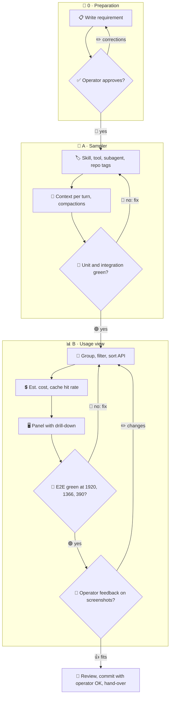

# 070 - Usage Explorer

## User Story

As the operator, I want a Resources view that breaks token use down by skill,
tool, subagent, repository, model, agent and account, with cost and cache
figures, so that I can find what costs the most and cut it.

## Decisions (operator-confirmed 2026-11-27; do not re-litigate)

1. **Attribution in the sampler** (operator): the host sampler
   (`orchestrator/client/resources.py`) tags each assistant message's usage
   with:
   - `skill`: the last Skill call earlier in the same session, `""` before
     any;
   - `tool`: the tool_use names in that message, `""` for text;
   - `subagent`: the agent type of a sidechain transcript, `""` for the main
     thread;
   - `repo`: the base name of the session's git top-level;
   - plus `model`, `agent` and `account` as today.

   Rows stay hourly, keyed by every dimension. Rejected: reusing the reports
   only (no skill dimension).
2. **Usage view** (operator): a new Resources panel. Group by one dimension
   (skill, tool, subagent, repo, model, agent, account, hour, day); filter by
   period and by any dimension's value; columns input, output, cache read,
   cache write, total, share, est. $, cache hit rate; sortable; clicking a row
   filters to it.
3. **Cost estimate** (operator): one price file per model family (input,
   output, cache read and cache write per million tokens, with its date); the
   column is labelled "est."; an unknown model shows "–".
4. **Context per turn** (operator, "everything capturable"): per agent and
   day, the median and p90 context per turn (input plus cache read) and the
   number of compactions, from the same scan.
5. **Bounded**: per hour at most 50 values per dimension; the rest fold into
   `(other)`. Retention as the existing token rows.
6. **Host only, names and counts only**: no prompt or tool input text is
   stored.

## Approach

## Acceptance Criteria

### Sampler

- [ ] A fixture transcript with a Skill call followed by two assistant
      messages tags both with that skill; the messages before it carry `""`.
- [ ] A message with two tool_use blocks counts under each tool name once.
- [ ] A sidechain transcript's tokens carry its agent type; the main thread's
      carry `""`.
- [ ] A 51st skill value within one hour lands in `(other)`.
- [ ] No row holds prompt text: a fixture's secret marker string appears in
      no output file.

### API and view

- [ ] `GET /api/usage?group=skill&since=<t>` answers rows with the eight
      columns; totals equal the sum of the token rows.
- [ ] Est. $ for a fixture model equals the hand-computed price; an unknown
      model gives null.
- [ ] Cache hit rate = cache read / (input + cache read) per row.
- [ ] The panel's group select, period select and row click filter as
      described; sorting by est. $ orders descending.

### Tests

- Unit:
  - [ ] Tagging, folding, price and hit-rate arithmetic in
        `tests/test_usage.py`.
- Integration:
  - [ ] `/api/usage` through the handler on fixture token rows.
- E2E:
  - [ ] `tests/e2e/test_resources_usage_e2e.py`: group switch, drill-down,
        screenshots at 1920, 1366 and 390.
