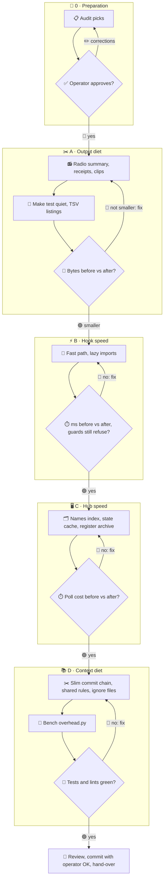

# 071 - Token and Velocity Diet

## User Story

As the operator, I want the skills, their hooks and the hub to cost fewer
tokens and less time per call, so that every agent works cheaper and faster
and I can re-measure it on demand.

## Decisions (operator-confirmed 2026-11-27; do not re-litigate)

1. **Source**: the skeptic audit of 2026-11-27 (master db3dee0); every fix
   here answers one of its rows and is proven by the same measurement before
   and after.
2. **All four bundles** (operator), in this order: output diet, hook speed,
   hub speed, context diet.
3. **Commit chain slimmed, names kept** (operator): kvb-code-clean,
   kvb-check-legal, kvb-check-score, kvb-check-break-risk, kvb-git-diff,
   kvb-check-confidence and kvb-code-scope-guard keep their names and
   triggers; each keeps its steps, details move to reference files read on
   demand, and repeated rules move to one shared file. Rejected: one merged
   pre-commit skill (every agent's commit flow would change at once).
4. **Bench in kvb-check-efficiency** (operator): `scripts/overhead.py`
   measures hook latency, script output bytes and hub poll cost;
   kvb-skill-silence, kvb-code-tune and kvb-optimize run it. Rejected: a new
   skill name (kvb-optimize already orchestrates both levers).
5. **Behaviour stays**: every guard keeps refusing what it refused; only
   output size, process count and parse work shrink.

## Approach

## Acceptance Criteria

### Output diet

- [ ] `radio.py show --all --since 7d` prints the summary form by default and
      no `read by` receipt rows; `--full` restores every row.
- [ ] One injected hook block holds at most 5 rows of at most 200 characters
      per channel, then one `+N more` line.
- [ ] `make test` prints no per-test line on success and every failure in
      full.
- [ ] `rasci.py show` ends with one `gaps: <n> (show --gaps)` line instead
      of every gap; `--gaps` lists them one per line. The table format stays,
      because the gaps line was larger than the 30 rows it followed.

### Hook speed

- [ ] `hooks.py pre-bash` on a `git status` event takes at least 40 % less
      median wall time than before (`overhead.py`), and every refusal case of
      `tests/test_hooks.py` still refuses.
- [ ] Prompt reminders whose schedule row is off exit without starting a
      Python process.

### Hub speed

- [ ] `names.json` drops the repeats of a name flip-flop: a fixture with 30k
      flip-flop entries shrinks below 60 entries, and the match cards'
      `born_of`, the renames, aliases, holders and current names stay
      identical (`test_hub_names`). Keeping only the newest entry per session
      and source was rejected: it erases the rename history.
- [ ] A state build reuses the speech phrasing of unchanged radio rows; on a
      copy of the live council it takes at most 60 % of its time before.
      Reusing the whole build while file mtimes hold was rejected: the
      council files change every few seconds and the build depends on the
      clock.
- [ ] `rasci.py` moves tasks `done` or `stopped` for more than 7 days to
      `rasci-archive.json`; `get`, `show --all`, `artifacts` and `tools`
      still list them, and a command naming one brings it back.

### Context diet

- [ ] The seven commit-chain SKILL.md files total at most 1,200 words, with
      names and descriptions' triggers unchanged.
- [ ] No skill description exceeds 25 words; `test_lock` budgets pass.
- [ ] `.ignore` and `.rgignore` exclude `.worktrees/`, `.state/`, `.agents/`,
      `.claude/` and `.continue/`.
- [ ] `test_queue_hung` patches its hang window to at most 0.2 s.

### Bench

- [ ] `kvb-check-efficiency/scripts/overhead.py` prints one line per case
      (median ms, output bytes) for the hook, radio and register cases;
      kvb-skill-silence, kvb-code-tune and kvb-optimize name it.

### Tests

- Unit:
  - [ ] The changed scripts' existing test modules plus new cases for the
        summary default, the injection cap, the names compaction and the
        archive.
- Integration:
  - [ ] `tests/test_hooks.py` dispatch cases unchanged in outcome.
- E2E:
  - [ ] The hub match and state pages render the same cards after the
        names compaction (existing `tests/e2e` match spec).
