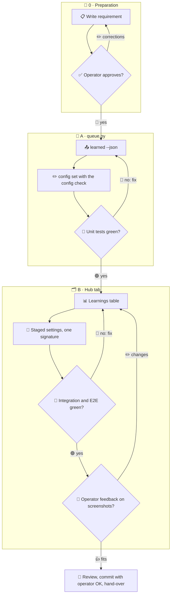

# 072 - Queue Controls Tab

## User Story

As the operator, I want the queue's learnings and settings in the hub,
editable with my passkey, so that I tune budgets and caps without editing
the queue's config file by hand.

## Decisions (operator-confirmed 2026-11-27; do not re-litigate)

1. **Own tab** (operator): a Controls tab "Queue" beside Rules and
   Schedules. Rejected: a section in the Rules page (the page grows long).
2. **Learnings read-only**: per kind runs, RAM and CPU share, slot limit,
   light flag and caps; per signature the learned rows; the last 20 history
   rows. `queue.py learned --json` delivers them and the hub runs it
   read-only.
3. **Settings editable** (operator: with passkey): `budget_percent`,
   `ram_cap_percent` per kind, `slots` and `load_limits`. Changes are
   staged; one passkey assertion signs the batch; the host runner runs
   `queue.py config set <key> <value>` by argv, and queue.py checks every
   value as its config check already does. Rejected: the hub writes the
   config file itself (it runs in a container without host write access);
   read-only only (operator wants to edit).
4. **No CPU cap per kind**: the operator picked the override (073) for a
   job the CPU budget holds. Rejected: `cpu_cap_percent`; throttling jobs
   through systemd scopes; booking CPU softly.

## Approach

## Acceptance Criteria

### queue.py

- [ ] `queue.py learned --json` prints kinds, signatures, budget, caps,
      load limits, slots and the last 20 history rows, and writes nothing.
- [ ] `queue.py config set <key> <value>` refuses a bad value with exit 2
      and leaves the config file byte-identical; a good value changes only
      its key.

### Hub

- [ ] The Queue tab shows the learnings table and the current settings.
- [ ] Staging two changes asks for one passkey assertion; the runner applies
      both by argv; the tab shows the new values after the next poll.
- [ ] The hub never writes the config file itself.

### Tests

- Unit:
  - [ ] `learned --json` and `config set` over fixture histories and
        configs.
- Integration:
  - [ ] The signed queue job through the HTTP handler and the runner's argv.
- E2E:
  - [ ] `tests/e2e/test_queue_tab_e2e.py`: table, staging, one signature,
        screenshots at 1920, 1366 and 390.
