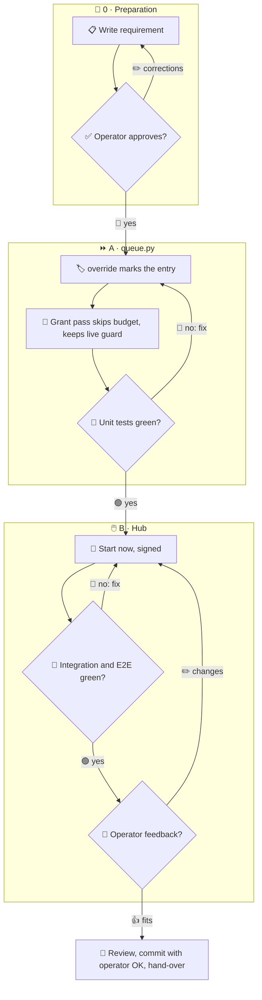

# 073 - Queue Override

## User Story

As the operator, I want to start one waiting queue job at once from the
hub, so that a gate does not wait on a budget I accept to exceed.

## Decisions (operator-confirmed 2026-11-27; do not re-litigate)

1. **Budget only** (operator): the override skips `budget_percent`, slot
   limits, reservations and rank; the live guard (`load_limits` CPU and
   memory) and the free-disk check stay. Rejected: skipping everything (out
   of memory, full disk); a warning step before the start (one more click).
2. **One job, one signature**: a "Start now" button on every waiting job in
   the Queue tab (072) and on its Kanban card; the passkey signs the job
   id; the host runner runs `queue.py override <id>` by argv.
3. **Honest learning**: `queue.py override <id>` marks the entry
   `{"override": {"ts": <epoch>}}`; the next grant pass grants it ahead of
   rank while the live guard allows; its history row records
   `override: true`.

## Approach

## Acceptance Criteria

### Queue

- [ ] An overridden queued entry is granted on the next pass although the
      budget would hold it.
- [ ] With CPU busy at or above `load_limits.cpu_percent` it still waits,
      and its reason names the live guard.
- [ ] `queue.py override` of an unknown or running id exits 2 and changes
      nothing.
- [ ] The job's history row carries `override: true`.

### Hub

- [ ] "Start now" signs once; the card shows the job granted within one
      poll.

### Tests

- Unit:
  - [ ] The grant pass with and without override, and the live guard.
- Integration:
  - [ ] The signed override job through the HTTP handler and the runner's
        argv.
- E2E:
  - [ ] `tests/e2e/test_queue_override_e2e.py`: "Start now" on a waiting
        fixture job, screenshots at 1920, 1366 and 390.
