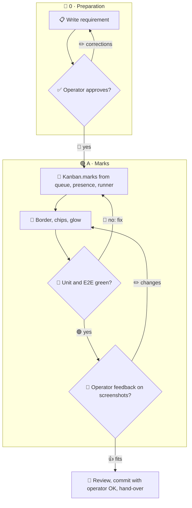

# 074 - Running on the Board

## User Story

As the operator, I want to see at a glance on the Kanban board what runs
right now and what kind of work it is.

## Decisions (operator-confirmed 2026-11-27; do not re-litigate)

1. **Three marks, all shown, told apart** (operator):
   - queue job active: icon `bi-cpu`, accent tone, job kind and runtime;
   - agent working: icon `bi-person-workspace`, ok tone, agent and since
     when;
   - hub job running: icon `bi-terminal`, info tone, the command's head.

   Sources: the active entries of `queue.json`, the presence heartbeats of
   the task's R or worker within the last 5 minutes, and `runner-job.json`.
2. **Card look** (operator: highlighted, gently pulsing, not intrusive): a
   2 px border in the mark's tone and a slow glow pulse of 3 s that
   animates opacity only, never size; several marks show several chips and
   the border takes the first in the order above; with
   `prefers-reduced-motion` the border stays static.
3. **Filter**: a board chip "Running" shows only marked cards.

## Approach

## Acceptance Criteria

### Marks

- [ ] A task with an active queue job shows the cpu chip with kind and
      runtime and the accent border.
- [ ] A task whose worker beat 2 minutes ago shows the agent chip; one that
      beat 10 minutes ago shows none.
- [ ] `runner-job.json` naming the task's row shows the terminal chip.
- [ ] The "Running" chip hides every unmarked card.

### Motion

- [ ] The glow animates only `opacity` over 3 s; `prefers-reduced-motion`
      stops it.

### Tests

- Unit:
  - [ ] `Kanban.marks` over fixtures of all three sources.
- Integration:
  - [ ] The state payload carries the presence and runner sources the board
        reads.
- E2E:
  - [ ] `tests/e2e/test_board_running_e2e.py`: chips, border, filter,
        screenshots at 1920, 1366 and 390.
