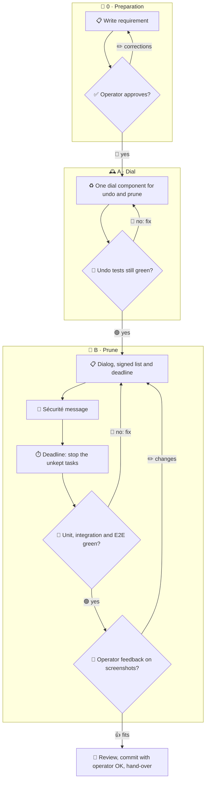

# 075 - Stale Task Prune

## User Story

As the operator, I want to prune stale tasks in one step, with the agents
able to object, so that the board stays clean.

## Decisions (operator-confirmed 2026-11-27; do not re-litigate)

1. **Stale** = an open task without a register change for N days and
   without a running mark (074); N starts at `Plan.STALE_DAYS` (3) and is
   set in the dialog (operator).
2. **Prune dialog** (operator): a checklist of the stale tasks, the days
   field and the answer deadline on the analog dial, 10 minutes to start
   with. The undo dial of `page-dial.js` is refactored into one dial
   component that both use.
3. **Announcement** (operator): on Prune one passkey assertion signs the
   list and the deadline, and the hub sends a Sécurité radio message to all
   that names every task and the deadline.
4. **Objection**: an agent keeps a task before the deadline with
   `rasci.py keep <task>`; any register change of the task counts as
   keeping it.
5. **Prune to stopped** (operator: option 1): at the deadline the runner
   sets every task nobody kept to stopped
   (`rasci.py set <task> --status stopped`); the register archive takes it
   after 7 days. Rejected: `rasci.py rm` (deleted for good).

## Approach

## Acceptance Criteria

### Dialog

- [ ] The dialog lists exactly the stale tasks for the chosen N.
- [ ] The deadline sits on the analog dial, and the dial counts down until
      it.

### Prune

- [ ] The Sécurité row names every task and the deadline.
- [ ] A task kept before the deadline stays open; every other listed task
      is stopped at the deadline.
- [ ] A task that was not in the signed list is never changed.

### Dial

- [ ] The undo dial and the prune dial are one component, and the undo
      tests pass unchanged.

### Tests

- Unit:
  - [ ] Stale selection, `rasci.py keep` and the deadline apply.
- Integration:
  - [ ] The signed prune job through the HTTP handler and the runner's
        argv.
- E2E:
  - [ ] `tests/e2e/test_stale_prune_e2e.py`: dialog, dial, countdown,
        screenshots at 1920, 1366 and 390.
