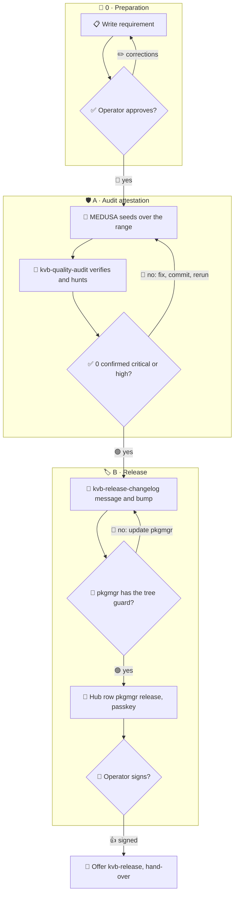

# 076 - Release Cut

## User Story

As the operator, I want one skill that audits a release range, writes the
changelog and hands me the signed release, so that nothing ships unaudited
and a release costs me one passkey click.

## Decisions (operator-confirmed 2026-11-27; do not re-litigate)

1. **Name and reach** (operator): `kvb-release-cut`, beside `kvb-release`
   (the announcement), `kvb-release-changelog` and the other `kvb-release-*`
   skills; it goes through to the signed release row. Rejected:
   `kvb-code-release` (a release is no code edit and would split the
   family); stopping at the message.
2. **Audit lives in Quality** (operator): the deep audit is Quality's
   `kvb-quality-audit` (Quality requirement 011), which pins Cloudflare's
   `security-audit` skill (MIT) at a commit, since upstream has no tags,
   keeps its output outside the repository's tracked tree and runs target
   code only sandboxed. This skill only orchestrates. Rejected: the
   audit in this repository (022: analysis lives once in Quality); release
   orchestration in Quality (it drives the register, operator rows and the
   hub).
3. **Before every release** (operator): the audit covers the range from the
   newest `vX.Y.Z` tag to HEAD. Pushes keep the cheaper 064 review.
   Rejected: on every push (a multi-agent audit per push); on demand only
   (no gate).
4. **MEDUSA seeds, the audit verifies** (operator): the MEDUSA scan of the
   range runs first and hands its findings to the audit's validation phase
   as candidates. A `rejected` verdict with its source trace becomes the
   acceptance row of `kvb-check-security`, so false positives need no
   manual skeptic round. The audit hunts its own logic and trust holes in
   parallel. Rejected: both side by side (the manual round stays); the
   audit replacing MEDUSA (loses its secret and CVE rules).
5. **Attestation**: the result is stored for the exact HEAD tree, as the
   064 stamp is. The skill calls Quality's
   `audit --repo <root> --range <tag>..HEAD --out <untracked dir> --budget <n>
   [--profile quick|standard|deep]` and reads
   `<out>/attestation-<tree id>.json`; a release needs its verdict `pass` (or
   `skipped` for a documentation-only range) for the HEAD tree. Exit 1
   (`blocked`) stops the skill. A `needs_validation` critical or high finding
   blocks like a confirmed one (operator pick in Quality requirement 011:
   fail closed).
6. **Cost first** (operator: as cheap and efficient as possible):
   - only files the range changes, plus the trust-boundary neighbours the
     audit's reconnaissance names;
   - MEDUSA from its per-file cache (010) and the 064 review memory, so
     reviewed blobs are not scanned again;
   - an unchanged tree reuses its attestation; a range of documentation
     only skips the audit and says so;
   - subagent models per `kvb-org-perform`; heavy phases through
     `queue.py hold`;
   - the run reports its tokens and minutes (`kvb-check-efficiency`).
7. **Release row** (operator): after a green attestation the skill runs
   `kvb-release-changelog` for the message and bump and adds one hub row
   `pkgmgr release <bump> -m <message>` with `--dir` set to the checkout to
   release, for the operator's passkey; the host runner runs it where GPG
   is. Then it offers `kvb-release` for the announcement.
8. **pkgmgr guards the tree** (PKGMGR, fix/release-cwd in package-manager):
   pkgmgr releases the git top level of its working directory and refuses
   before touching a file when that checkout has tracked changes. The skill
   requires a pkgmgr version with that fix and runs no zero-change check of
   its own. Rejected: a `kvb-pkgmgr-release` wrapper (the trap belongs fixed
   where it lives).

## Approach

## Acceptance Criteria

### Attestation

- [ ] Without a green attestation for the HEAD tree the skill adds no
      release row and names the missing piece.
- [ ] A MEDUSA finding the audit rejects lands as an acceptance row with the
      audit's source trace; a confirmed one blocks the release.
- [ ] An unchanged tree reuses its attestation without a new audit run.
- [ ] A range of documentation only skips the audit and says so.

### Release

- [ ] Against a pkgmgr without the fix/release-cwd change the skill stops
      before the row and names the missing version.
- [ ] The row carries `--dir <checkout>`, `pkgmgr release <bump> -m
      <message>` with the message from `kvb-release-changelog`, and the
      attested tree hash.
- [ ] The run prints its tokens and minutes.

### Tests

- Unit:
  - [ ] Attestation lookup, reuse, the documentation-only skip and the
        zero-change check over fixture repositories.
- Integration:
  - [ ] A fake audit and a fake MEDUSA through the skill's script: rejected
        findings become acceptance rows; a confirmed one blocks.
- E2E:
  - n/a: the release row is an operator row; the hub's row E2E covers it.
