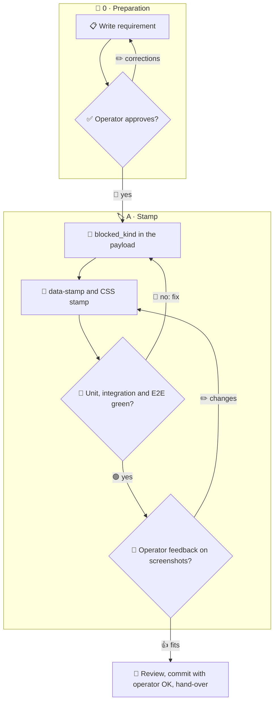

# 077 - Stamp on Greyed Cards

## User Story

As the operator, I want every greyed Match card to carry a fixed stamp that
names why it is greyed, so that I see the reason without hovering.

## Decisions (operator-confirmed 2026-11-27; do not re-litigate)

1. **One stamp per reason** (operator): `RUNNING` in the info tone while the
   hub runner runs the row, `QUEUED` in the warn tone while it waits in the
   runner, `STALE` in the muted tone for a stale card. The hub sends
   `blocked_kind` (`running` or `queued`) next to the `blocked` text of
   `blocked_reasons()` in `kvb_orchestrator/jobs.py`, so the page never
   parses prose.
2. **Look** (operator: like the later and accept stamps, only fixed): the
   stamp of `style-match.css` for `ACCEPT`, `REJECT` and `LATER` (4 px
   border, rounded, bold caps, slight rotation), fixed in the card's centre,
   always at full opacity, never following a swipe. The stamp keeps its
   colour while the card stays greyscale: the `grayscale` filter moves from
   the card to its children. The tooltip and the hourglass line stay.
3. **Scope**: the front card of Match. Peek tabs keep their tooltip.
   Rejected: Inbox and Stream rows (rows, not cards).

## Approach

## Acceptance Criteria

### Stamp

- [ ] A front card whose row the runner runs shows `RUNNING`, a queued one
      `QUEUED`, a stale one `STALE`.
- [ ] The stamp's computed colour is not grey and its opacity is 1.
- [ ] A swipe gesture on a greyed card neither moves nor hides the stamp.
- [ ] A card that is not greyed shows no fixed stamp.

### Tests

- Unit:
  - [ ] `blocked_reasons` returns the kind for a running and a queued job.
- Integration:
  - [ ] The Match state payload carries `blocked_kind` for a blocked card.
- E2E:
  - [ ] `tests/e2e/test_match_stamp_e2e.py`: all three stamps, colour and
        opacity probe, screenshots at 1920, 1366 and 390.
