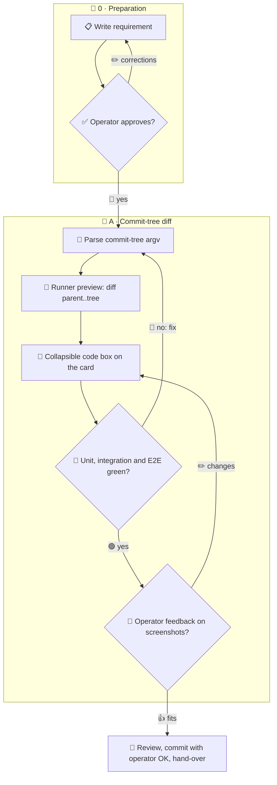

# 078 - Diff on Commit-Tree Cards

## User Story

As the operator, I want an ask card for `git commit-tree` to show the diff
from its parent to its tree, so that I never approve a commit blind.

## Decisions (operator-confirmed 2026-11-27; do not re-litigate)

1. **Source**: the runner's existing preview, which already computes diffs
   for merge rows, also covers `git commit-tree <tree> -p <parent>` asks. It
   runs `git diff <parent> <tree>` read-only in the ask's working directory.
   Rejected: the hub reading the repository itself (the container has no
   access to host repositories).
2. **Look** (operator: hide and show again): the same collapsible code box
   with the eye toggle as on commit cards, open by default.

## Approach

## Acceptance Criteria

### Diff

- [ ] A commit-tree ask with a resolvable parent and tree shows every changed
      file with its hunks.
- [ ] The eye toggle hides and shows the diff; it starts open.
- [ ] An unresolvable tree or parent shows its git error line instead of the
      diff.
- [ ] The preview runs no git command that writes (no `commit-tree`, no
      `update-ref`).

### Tests

- Unit:
  - [ ] Parsing a commit-tree argv yields tree and parent; an argv without
        `-p` yields none.
- Integration:
  - [ ] The runner preview delivers the files of a commit-tree ask in a
        scratch repository.
- E2E:
  - [ ] `tests/e2e/test_commit_tree_diff_e2e.py`: diff shown, toggle, error
        line, screenshots at 1920, 1366 and 390.
