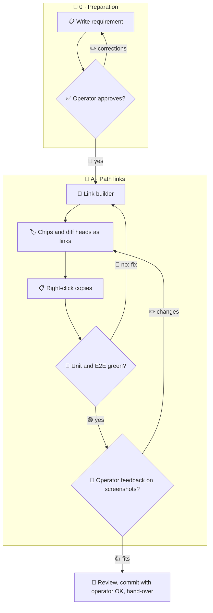

# 079 - Paths Open in VS Code

## User Story

As the operator, I want to click folder and file names on cards and have them
open in VS Code, so that I inspect a change without typing its path.

## Decisions (operator-confirmed 2026-11-27; do not re-litigate)

1. **`vscode://file/<absolute path>`** (operator): a file opens in VS Code, a
   folder opens as a window. Rejected: a file viewer in the hub (new trust
   boundary, the container would read host files); a browser extension
   (effort); a runner `xdg-open` (a signature per click).
2. **Where**: the folder chip, the worktree chip, and the file head of every
   diff (worktree plus relative path).
3. **Copy**: right-click copies the full path, as left-click does today.

## Approach

## Acceptance Criteria

### Links

- [ ] The `href` of the folder chip is exactly `vscode://file/<absolute path>`.
- [ ] The worktree chip links the same way to its worktree.
- [ ] A diff file head links to `<worktree>/<path>`.
- [ ] Right-click on a link copies the full path and opens no context menu.
- [ ] A relative or empty path renders as text without a link.

### Tests

- Unit:
  - [ ] The link builder (node): absolute path, characters needing encoding,
        relative and empty path.
- Integration:
  - n/a: page only, no hub or runner change.
- E2E:
  - [ ] `tests/e2e/test_path_links_e2e.py`: hrefs and right-click copy,
        screenshots at 1920, 1366 and 390.
