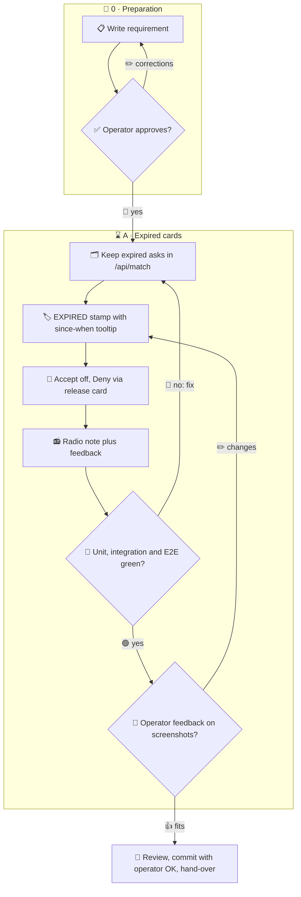

# 080 - Expired Cards Stay

## User Story

As the operator, I want expired asks and decisions to stay greyed out with a
stamp, so that I see what went unanswered and can still answer it.

## Decisions (operator-confirmed 2026-11-27; do not re-litigate)

1. **Kept**: an expired ask or decision stays a Match card until the operator
   denies it, greyed out, with the `EXPIRED` stamp of 077. Hovering the stamp
   shows a tooltip naming since when the card is expired (operator).
2. **Only Deny**: Accept is disabled, because the tool call has already gone
   back to the terminal. Deny goes through the release card like every
   rejection. The agent gets "expired before the operator decided" by radio,
   plus the operator's feedback text.
3. **Only unrun asks, 24 h** (operator): the hub keys each ask by session,
   tool and a digest of the tool input (the PermissionRequest hook input
   carries no `tool_use_id`); an async PostToolUse hook reports each call
   that ran, and a matching pending ask created before it closes as answered
   in the terminal and leaves Match. Only an
   expired ask whose call never ran stays, at most 24 h after its expiry.
   Rejected: a fixed 1 h window (shows asks already answered in the
   terminal); every expired ask until denied (2239 undecided asks on
   2026-11-27 would flood the deck).

## Approach

## Acceptance Criteria

### Card

- [ ] An ask or decision past its `expires` is still in `/api/match` with
      `blocked_kind: "expired"` and its `expires` time.
- [ ] The card shows the `EXPIRED` stamp; hovering it shows a tooltip with
      the expiry time and how long ago it was.
- [ ] Accept is disabled on the card; Reject works.
- [ ] An expired ask whose call ran afterwards (same session, tool and input
      digest) is closed as answered in the terminal and is not in
      `/api/match`.
- [ ] An expired ask more than 24 h past its `expires` is not in
      `/api/match`.

### Release

- [ ] After the release, the agent's radio holds "expired before the
      operator decided" and the feedback text.
- [ ] After the release, the card is gone from `/api/match`.

### Tests

- Unit:
  - [ ] The expired filter keeps an expired ask with `blocked_kind:
        "expired"` and drops a decided one.
- Integration:
  - [ ] A denied expired card goes through the release and posts the radio
        note.
- E2E:
  - [ ] `tests/e2e/test_match_expired_e2e.py`: stamp, tooltip text, Accept
        disabled, Deny, screenshots at 1920, 1366 and 390.
