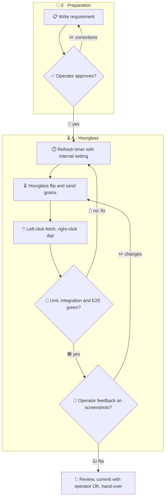

# 081 - Match Refresh Hourglass

## User Story

As the operator, I want to see when Match fetches its cards next, so that I
know whether an empty deck is current.

## Decisions (operator-confirmed 2026-11-27; do not re-litigate)

1. **Interval stays 2 s** (operator): it costs no tokens, only a request from
   the browser to the hub.
2. **Hourglass** (operator): small in the Match head, large in the empty
   deck. It flips fast after every fetch, and small sand grains run during
   the interval. Rejected: an analog clock that jumps.
3. **Clicks**: right-click sets the interval with the generic dial of 075 (1
   to 60 s, stored in the hub settings); left-click fetches at once.
4. **Reduced motion**: `prefers-reduced-motion` shows a still hourglass.

## Approach

## Acceptance Criteria

### Refresh

- [ ] With the default, Match fetches `/api/match` once every 2 s ±0.3 s.
- [ ] A left-click on the hourglass fetches at once and restarts the cycle.
- [ ] An interval of 10 s set by right-click survives a reload.

### Look

- [ ] After a fetch, the hourglass has flipped within 1 s.
- [ ] The empty deck shows the large hourglass, the head the small one.
- [ ] Under `prefers-reduced-motion: reduce` no animation runs.

### Tests

- Unit:
  - [ ] The timer arithmetic (node): next fetch time, restart on click,
        interval bounds 1 and 60 s.
- Integration:
  - [ ] The interval is stored in and read from the hub settings.
- E2E:
  - [ ] `tests/e2e/test_match_hourglass_e2e.py`: fetch rate, left-click,
        right-click dial, reduced motion, screenshots at 1920, 1366 and 390.
