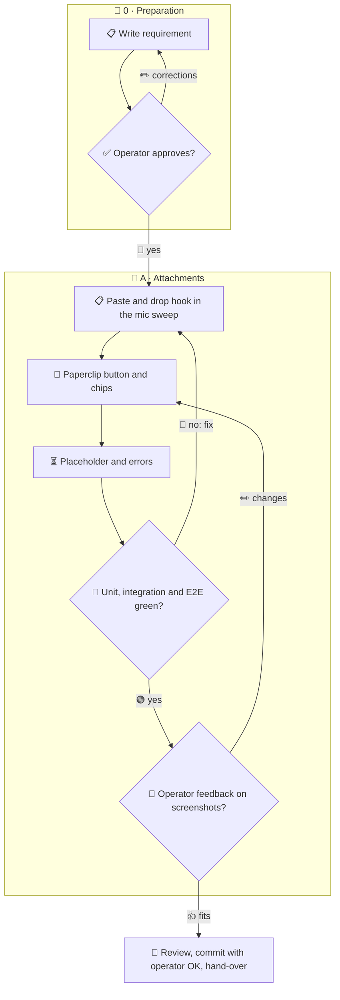

# 082 - Attachments in Every Text Field

## User Story

As the operator, I want to attach files in every hub text field, by pasting a
screenshot with Ctrl+V, dropping a file or clicking a paperclip, so that
agents get my screenshots without a detour.

## Decisions (operator-confirmed 2026-11-27; do not re-litigate)

1. **Path line in the text** (operator): the file goes through
   `/api/uploads`, and the line `📎 <host path>` lands at the cursor. The
   signed text carries the path; the signature format stays. Rejected: a
   list of uploads in the signed radio message (changes
   `signing.message_item` and every message consumer).
2. **One hook**: the `micFrame` sweep of `page-mic.js` already frames every
   text field; it also wires paste and drop there. A textarea additionally
   gets a 📎 button in its footer next to the mic and one chip per
   attachment: a thumbnail for an image, a file icon otherwise, and ✕
   removes chip and line.
3. **Placeholder**: `📎 uploading <name>…` stands at the cursor until the
   upload answers; then it becomes the path line, or the error text on a
   failure (over 50 MiB, hub unreachable). A pasted image without a name is
   named `paste-<timestamp>.png`.
4. **Plain text stays plain**: Ctrl+V of text pastes as before; only files
   upload.

## Approach

## Acceptance Criteria

### Attach

- [ ] Ctrl+V of an image in the reject feedback inserts
      `📎 <host path>/paste-<timestamp>.png`, and the file exists below
      `uploads/<id>/`.
- [ ] Dropping a file on the composer, the accept notes or a decision's
      Other field inserts its path line.
- [ ] The 📎 button opens the file picker; the chosen file's line lands at
      the cursor.
- [ ] Ctrl+V of plain text uploads nothing.

### Chips and errors

- [ ] Every attachment of a textarea shows a chip: a thumbnail for an image,
      a file icon otherwise.
- [ ] ✕ on a chip removes the chip and its line from the text.
- [ ] A failed upload replaces the placeholder with the error text and
      inserts no path.

### Tests

- Unit:
  - [ ] Path line, name of a pasted image and placeholder swap (node).
- Integration:
  - [ ] `/api/uploads` stores a PNG body and returns the host path the line
        names.
- E2E:
  - [ ] `tests/e2e/test_field_attachments_e2e.py`: synthetic paste, drop and
        picker in the reject feedback and the composer, chip ✕, an upload
        over the limit, screenshots at 1920, 1366 and 390.
