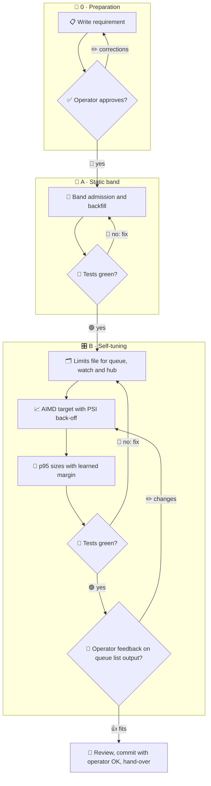

# 083 - Self-Tuning Queue Admission

## User Story

As the operator, I want the queue to keep the average CPU and RAM load
between its lower and upper limit on its own, so that no job waits while the
host idles and no job tips the host over.

## Decisions (operator-confirmed 2026-11-27; do not re-litigate)

1. **Static band as the base**: a job is granted while the load sits below
   the lower limit and its learned footprint keeps the load at or below the
   upper limit; smaller jobs backfill around a waiting head job without
   starving it. It lands first.
2. **AIMD target** (operator): a target between the lower and the upper
   limit. Plus 2 points per poll while the 10-minute average stays below the
   lower limit and no memory pressure (PSI) shows; on a load above the upper
   limit, rising PSI or swap-out it drops at once to the middle between the
   lower limit and its value. One grant per settle window (one load sample
   window).
3. **Learned sizes** (operator): per command the p95 peak RAM footprint
   instead of the mean, times a margin learned from the error of past
   predictions. CPU keeps the median (operator 2026-11-27): a neighbour's
   CPU spike must not lift a booking, and CPU overload only slows.
4. **One limits file**: lower and upper limit, STOP and MAYDAY per CPU, RAM,
   swap, disk and PSI in one file in the council directory; queue, watch and
   hub read it, the live target sits next to it. Per metric lower < upper <
   STOP < MAYDAY.
5. **Rejected**: a forecasting scheduler (high effort for little over AIMD);
   hard cgroup memory caps per job (a job above its cap is killed).

## Approach

## Acceptance Criteria

### Admission

- [ ] Over a simulated load series the target rises by 2 per poll below the
      lower limit and falls to the middle after one poll above the upper
      limit or with rising PSI.
- [ ] At most one grant per settle window.
- [ ] A grant is refused when used plus the job's p95 footprint times its
      margin would exceed the target.
- [ ] The margin grows after a job used more than predicted and shrinks
      after one used less.
- [ ] `queue.py list` names the target and each waiting job's reason.

### Limits file

- [ ] Queue and watch read their limits from the limits file.
- [ ] A file that breaks lower < upper < STOP < MAYDAY is refused and the
      previous limits stay in force.

### Tests

- Unit:
  - [ ] Target steps, margin update and order check.
- Integration:
  - [ ] One queue pass over a load series grants and refuses as above.
- E2E:
  - n/a: no page; the board side is requirement 084.
