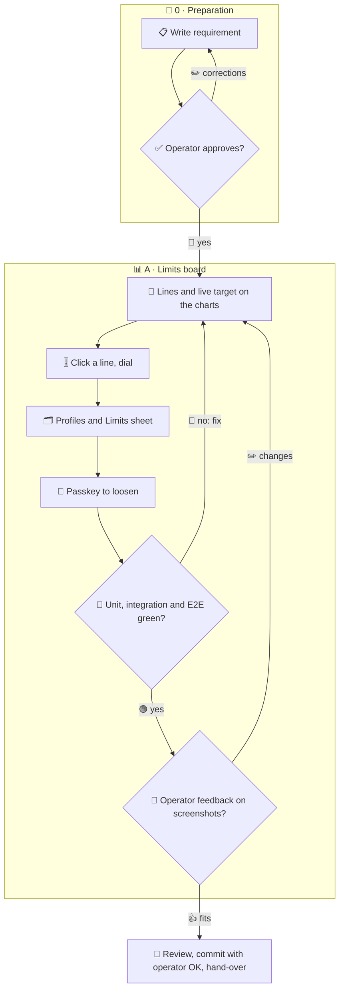

# 084 - Limits on the Resources Board

## User Story

As the operator, I want to see and set the load limits right on the hardware
charts, so that I steer the queue and the alarms without config files.

## Decisions (operator-confirmed 2026-11-27; do not re-litigate)

1. **Lines** (operator): every hardware chart (CPU, RAM, swap, disk, PSI)
   shows labelled lines for the lower and upper limit, STOP and MAYDAY from
   the limits file of 083, plus a thin line for the live target. Rejected:
   dragging the lines (accidental moves, poor on touch).
2. **Click a line, get a dial**: a click opens the generic dial of 075 for
   exactly that value.
3. **Profiles**: a switch Calm (band 50 to 70), Balanced (70 to 90) and Max
   (80 to 95) sets all limits at once; a Limits sheet lists every value in
   one table, each with its dial.
4. **Passkey to loosen** (operator): a tighter value applies at once; a
   looser one (higher upper limit, STOP or MAYDAY, or a looser profile)
   needs the passkey signature.

## Approach

## Acceptance Criteria

### Lines and dial

- [ ] Every hardware chart shows its four limit lines and the target line,
      each with a label and a tooltip carrying its value.
- [ ] A click on a line opens the dial; a tighter value is saved without a
      signature and lands in the limits file of 083.
- [ ] A value that breaks lower < upper < STOP < MAYDAY shows an error and
      is not saved.

### Profiles and passkey

- [ ] A profile switch moves every line.
- [ ] A looser value or profile asks for the passkey; a cancel keeps the old
      value.

### Tests

- Unit:
  - [ ] Order check and the tighter-or-looser classification (node).
- Integration:
  - [ ] The hub endpoint refuses a looser value without a passkey proof and
        accepts it with one.
- E2E:
  - [ ] `tests/e2e/test_resource_limits_e2e.py`: lines, dial, profile switch,
        passkey path, screenshots at 1920, 1366 and 390.
