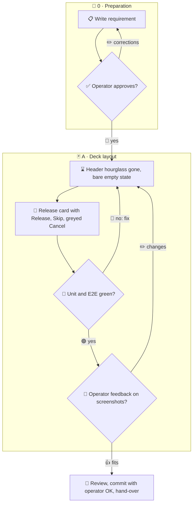

# 085 - Calm Match Deck Layout

## User Story

As the operator, I want the Match deck to show only what helps me decide and
to treat the release card like every other card, so that I swipe through the
deck without hunting for a special button.

## Decisions (operator-confirmed 2026-11-27; do not re-litigate)

1. **No header hourglass** (operator): the hourglass next to "Match" in the
   page header goes; the card count stays. An hourglass shows bottom right
   only in the countdown dialog that follows a release (the undo window).
2. **Bare empty state** (operator): the hourglass between cards stays, as
   icon and text only, without the dashed frame, centred horizontally and
   vertically in the deck container.
3. **Release card is a deck card** (operator): no "Release N decisions"
   button inside the card. The card has the deck's normal action row: a
   Release button bottom right, a Skip button and on the left the red Cancel
   of 092, which drops the unreleasable rows and is greyed while there are
   none. Swipe right, D or → releases; swipe left, A or ← skips; S undoes,
   exactly as on every other card.
4. **Held stays held**: while a risk exception is open (081 rule) Release
   stays greyed with the held note as its tooltip.
5. **Fixed card height** (operator): in the widget view and on the page
   every card has the same height, the deck container's; a longer card
   scrolls inside. Reject, Skip and Accept sit at the same place for every
   card, anchored to the outer container, so the hand never searches.

## Approach

## Acceptance Criteria

### Header and empty state

- [ ] The Match page header holds no hourglass icon; the undo countdown
      dialog after a release shows one in its bottom-right corner.

### Card height and buttons

- [ ] In the widget at 390 x 900 and on the page at 1366, a short and a long
      card have the same height; the long one scrolls inside.
- [ ] The Reject and Accept buttons' bounding boxes are identical (within
      1 px) for a short and a long card.
- [ ] The empty deck shows hourglass and text with no border, their centre
      within 4 px of the deck container's centre on both axes.

### Release card

- [ ] The release card holds no button labelled "Release N decision(s)".
- [ ] Its action row shows Release (bottom right), Skip and the Cancel of
      092 on the left.
- [ ] Swipe right, D and → release; swipe left, A and ← skip to the next
      card; S undoes.
- [ ] With a held risk card Release is disabled and its tooltip names the
      held card.

### Tests

- Unit:
  - n/a: layout only; the release plan logic is unchanged.
- Integration:
  - n/a: no server change.
- E2E:
  - [ ] `tests/e2e/test_match_release_card_e2e.py`: action row, greyed
        Cancel, keys and swipe, held state.
  - [ ] `tests/e2e/test_match_empty_state_e2e.py`: no header hourglass,
        centred bare empty state at 1920, 1366 and 390.
