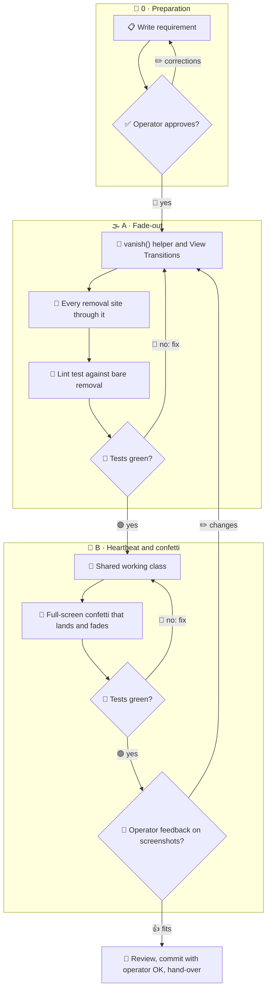

# 086 - Hub Motion Language

## User Story

As the operator, I want every element to leave with a short fade, working
things to beat like a heart and confetti to fall over the whole screen, so
that I see at a glance what changed, what works and what is done.

## Decisions (operator-confirmed 2026-11-27; do not re-litigate)

1. **Nothing vanishes abruptly, everywhere** (operator): one shared
   `vanish(el)` helper fades and collapses an element in about 180 ms before
   it leaves the DOM (cards, toasts, modals, chips, rows, menus); list
   re-renders run through View Transitions so leaving items fade too. A lint
   test refuses a bare `.remove()` or `replaceChildren()` on a visible
   element outside the helper. `prefers-reduced-motion` removes at once.
   Rejected: ghost clones kept in every render (more code, same effect).
2. **Heartbeat for working objects** (operator): one shared CSS class marks
   anything that works right now (running task, running queue job, busy
   agent, live deploy): a double beat ("lub-dub") about every 1.2 s of a
   slight scale and a soft glow in its state colour. Queued, waiting,
   stale and dead objects stay still. Reduced motion keeps the glow without
   the beat.
3. **Confetti over the whole screen** (operator): it starts just below the
   top control bar, spreads over the full viewport width, falls to the
   bottom edge, lies there, and fades to transparent after a few seconds.
   Rejected: confetti only inside the deck.

## Approach

## Acceptance Criteria

### Fade-out

- [ ] A removed card, toast, modal, menu and list row keeps an opacity
      between 0 and 1 for at least 100 ms before it leaves the DOM.
- [ ] With `prefers-reduced-motion: reduce` it leaves at once.
- [ ] The lint test fails on a template with a bare `.remove()` of a
      visible element outside `vanish()`.

### Heartbeat

- [ ] Running tasks, running queue jobs and busy agents carry the working
      class; queued, waiting, stale and ended ones do not.
- [ ] The working class animates scale and box-shadow; under reduced
      motion only the box-shadow.

### Confetti

- [ ] Confetti pieces start below the bottom edge of the top control bar
      and spread over at least 90 % of the viewport width.
- [ ] Pieces come to rest at the bottom edge and reach opacity 0 within
      10 s, after which no confetti node or canvas remains.

### Tests

- Unit:
  - [ ] The lint test over every template (`tests/test_page_motion.py`).
- Integration:
  - n/a: no server change.
- E2E:
  - [ ] `tests/e2e/test_hub_motion_e2e.py`: a dismissed toast and a
        released card fade, a running task beats, confetti lands and fades,
        reduced motion removes at once.
