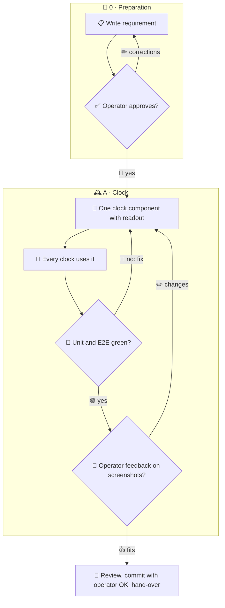

# 087 - Time Readout on Every Analog Clock

## User Story

As the operator, I want every analog clock in the hub to print its time
below the pivot while its hand keeps sweeping, so that I read the exact value
without estimating the hand's angle.

## Decisions (operator-confirmed 2026-11-27; do not re-litigate)

1. **Readout under the pivot** (operator): every analog clock (match clock,
   undo dial, prune dial, schedule and limits dials, any later one) prints
   its value inside the face, centred just below the hand's pivot.
2. **Countdown where it counts down** (operator): a clock that runs out (the
   green answer window of the prune dialog, undo) shows the remaining time
   as m:ss; a wall clock shows the time of day.
3. **Always animated** (operator): the hand moves continuously and smoothly,
   not in jumps; the readout updates every second.
4. **One component**: all clocks share one clock component, so the readout
   cannot be missing on one of them.

## Approach

## Acceptance Criteria

### Readout

- [ ] Every analog clock on every page holds a readout element inside the
      face below the pivot.
- [ ] The prune dialog's clock reads m:ss and decreases by one each second.
- [ ] The hand's angle changes between two frames 100 ms apart.

### Tests

- Unit:
  - [ ] The readout format for wall time and countdown (node).
- Integration:
  - n/a: no server change.
- E2E:
  - [ ] `tests/e2e/test_clock_readout_e2e.py`: match clock, undo dial and
        prune dial show and update their readout.
