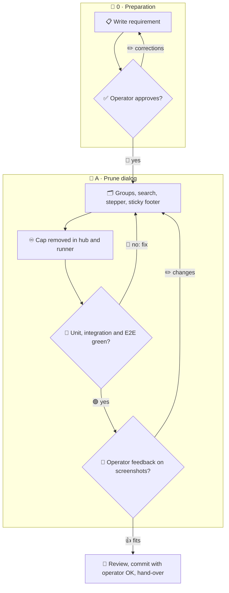

# 088 - Grouped Prune Dialog

## User Story

As the operator, I want the stale tasks in the prune dialog grouped and
searchable and pruned in one go however many there are, so that I keep the
overview with hundreds of tasks.

## Decisions (operator-confirmed 2026-11-27; do not re-litigate)

1. **Grouped by prefix** (operator): the tasks group by their prefix (`ci/`,
   `cluster/`, `work/`, `fix/` and so on), each group collapsible with a
   tri-state group checkbox and its count; inside, one row per task with its
   owner's avatar and its age as a chip. Rejected: a sortable table, age
   buckets.
2. **Search and stepper**: a filter field narrows the rows; the stale age is
   a number stepper without a mic button.
3. **Sticky footer**: the clock of 087 and "Prune N" stay visible while the
   list scrolls.
4. **No 50-task cap** (operator: drop it without a reason): 075 never asked
   for it; 258 task slugs take about 12 KB of the hub's 1 MiB body limit. The
   check keeps distinct, valid slugs outside `operator/` and `hotfix/`; the
   body limit is the only bound. Rejected: batches (no constraint needs
   them).

## Approach

## Acceptance Criteria

### Dialog

- [ ] The tasks show in one group per prefix with count and group checkbox;
      unticking one row sets its group checkbox to indeterminate.
- [ ] Typing in the filter hides rows that do not match and updates "Prune
      N".
- [ ] The footer with clock and Prune button stays in view after scrolling
      the list to its end.
- [ ] The stale age field has no mic button.

### Cap

- [ ] A signed prune of 300 distinct tasks passes `pruning.checked_tasks`
      and the runner.
- [ ] Duplicates, invalid slugs and `operator/` or `hotfix/` tasks are still
      refused.

### Tests

- Unit:
  - [ ] `checked_tasks` with 300 tasks and the refusals.
- Integration:
  - [ ] A prune of 300 tasks through the HTTP handler and the runner.
- E2E:
  - [ ] `tests/e2e/test_stale_prune_e2e.py`: groups, tri-state, filter,
        sticky footer, 258 tasks pruned in one signature.
