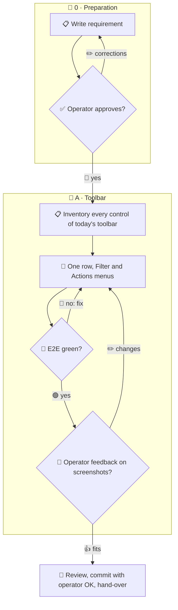

# 089 - One-Row Task Toolbar

## User Story

As the operator, I want the task board's toolbar in one calm row with every
function still one or two clicks away, so that I find a function without
scanning two crowded rows.

## Decisions (operator-confirmed 2026-11-27; do not re-litigate)

1. **One row, two menus** (operator): view switcher, search field, a Filter
   menu and an Actions menu, then the task count. Rejected: a filter sidebar.
2. **Filter menu**: the status tabs (All, Open, Open work, Waits on
   Operator, Waiting for a grant, Ended) as one radio group with their
   counts, and the toggles Running, Stale, Queue line and Queue jobs. The
   active filter shows as one removable chip next to the menu.
3. **Actions menu**: Prune stale, Request choices, Undo with its timer, and
   every other action button of today's two rows.
4. **Nothing lost**: every control of today's toolbar is reachable in at
   most two clicks; keyboard shortcuts stay.

## Approach

## Acceptance Criteria

### Layout

- [ ] At 1920 and 1366 px the toolbar is one row; at 390 px it wraps to at
      most two.
- [ ] Every control in the inventory of today's toolbar is reachable within
      two clicks (listed in the E2E spec).
- [ ] A chosen filter shows as a chip; its ✕ resets to All.

### Tests

- Unit:
  - n/a: layout only.
- Integration:
  - n/a: no server change.
- E2E:
  - [ ] `tests/e2e/test_task_toolbar_e2e.py`: one row, every inventoried
        control reachable, filter chip, screenshots at 1920, 1366 and 390.
