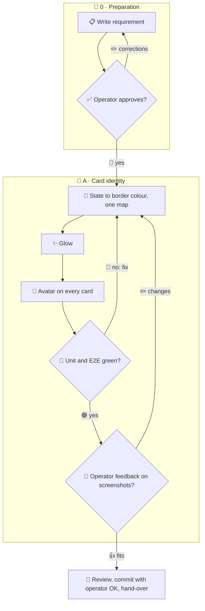

# 090 - Task Card State Colour and Owner Avatar

## User Story

As the operator, I want each task card's colour to mean exactly one state
and to carry its agent's avatar, so that I see whose card it is and how it
stands without reading it.

## Decisions (operator-confirmed 2026-11-27; do not re-litigate)

1. **Border = state** (operator): the whole card border carries the state
   colour, one colour per meaning: green running, amber waits on the
   operator, blue queued or waiting for a grant, red blocked or failed, grey
   dashed stale, muted ended. Chips stay neutral. Rejected: a left stripe.
2. **Soft glow** (operator): a slight, shiny glow in the border colour
   fades around the card; on running cards it beats with the heartbeat of
   086.
3. **Avatar** (operator): every kanban card shows its owner agent's avatar
   top left, the same avatar the agents page uses; a card without an owner
   shows a neutral placeholder.
4. **Legend**: the board's info button lists the colours with their
   meaning.

## Approach

## Acceptance Criteria

### Colour

- [ ] One map from state to colour exists; every card's border colour comes
      from it.
- [ ] No two states share a border colour; a running card and a stale card
      never look alike.
- [ ] The info legend lists every entry of the map.

### Avatar

- [ ] Every kanban card holds an avatar image of its owner or the
      placeholder.

### Tests

- Unit:
  - [ ] The state map is total over the register's states (node).
- Integration:
  - n/a: no server change.
- E2E:
  - [ ] `tests/e2e/test_task_card_identity_e2e.py`: one card per state with
        its colour, glow and avatar, screenshots.
