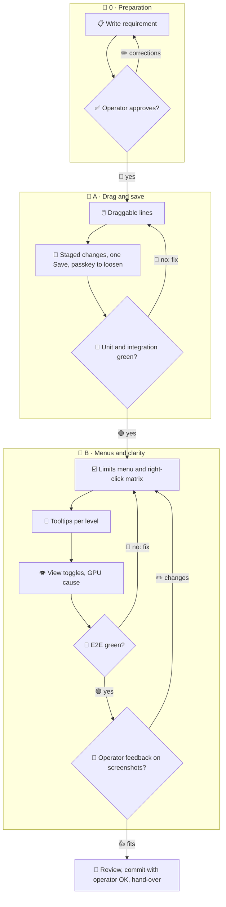

# 091 - Limits Dragged on the Resources Chart

## User Story

As the operator, I want to drag the limit lines on the Resources chart,
switch limits, legend and markers on and off, and read what each limit
does, so that I steer the queue from one clear chart. This replaces
decisions 1 and 2 of 084 (no drag, a dial per line).

## Decisions (operator-confirmed 2026-11-27; do not re-litigate)

1. **Drag the lines** (operator): lower, upper, STOP and MAYDAY of the shown
   metric are lines on the chart that move vertically by mouse or touch. A
   moved line turns dashed with its new value and old value.
2. **Stage, then one Save** (operator): moved lines collect in a bar "Save N
   changes / Discard"; one passkey signature covers every loosening value,
   tightening only saves without one (084 decision 4 stays). An order
   break (lower < upper < STOP < MAYDAY) blocks Save and names the line.
3. **Limits menu** (operator): the toolbar's Limits button becomes a menu
   with a checkbox per level (lower, upper, STOP, MAYDAY, target) to show or
   hide its lines, the profiles, and "Matrix…" for the full table; a right
   click on the chart opens the same matrix. The dial goes.
4. **Tooltips that explain** (operator): hovering a level's name or line
   says what it means and what it does, for example "upper: the queue
   starts no job whose footprint would lift the load above it".
5. **Clear chart** (operator): a View menu toggles the legend, the queue
   markers, the wait bands and the limit lines; series stay toggled by their
   legend chip. Every toggle is remembered per browser.
6. **Readable unknowns**: a GPU span without a reading names its cause in
   its tooltip (`nvidia-smi` error line, for example "driver/library version
   mismatch: reboot") instead of only "unknown". Found 2026-11-27: the
   userspace driver 620.70.06 against kernel module 615.71.09 since 14:14 UTC.

## Approach

## Acceptance Criteria

### Drag and save

- [ ] Dragging the upper line of CPU from 90 to 85 shows a dashed line at
      85 and "Save 1 change".
- [ ] Save of a tighter value writes `limits.json` without a passkey; a
      looser one asks once for all staged changes; Discard restores the
      lines.
- [ ] Dragging upper above STOP disables Save and names the line.

### Menus and tooltips

- [ ] The Limits menu hides and shows each level's lines; "Matrix…" and a
      right click open the matrix.
- [ ] Each level name and line has a tooltip with its meaning and effect.
- [ ] The View menu toggles legend, queue markers, wait bands and limit
      lines, and the choice survives a reload.

### GPU cause

- [ ] `resources.py` keeps the first `nvidia-smi` error line of a failed
      read in the sample; the unknown span's tooltip shows it.

### Tests

- Unit:
  - [ ] Pixel to value and back, staged change classification (node);
        `resources.py` error capture.
- Integration:
  - [ ] The limits endpoint takes a batch of staged changes, one passkey
        proof for the looser ones.
- E2E:
  - [ ] `tests/e2e/test_resource_limits_e2e.py`: drag, stage, save,
        passkey, order break, menus, right click, tooltips, view toggles,
        screenshots at 1920, 1366 and 390.
