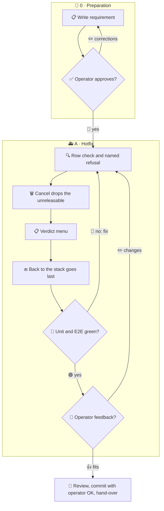

# 092 - Release Card Repairs

## User Story

As the operator, I want the release card to name and drop the rows that can
no longer be released, to let me change a decision right in its row and to
send a card back behind the release card, so that one expired card never
blocks the whole release.

## Decisions (operator-confirmed 2026-11-27; do not re-litigate)

1. **Hotfix** (operator): lands before 085 to 091. Cause found 2026-11-27: an
   Ask accepted while pending expired before the release; the hub refused the
   whole batch with `409 {"id": "b63ce250…", "status": "expired"}` and the
   toast showed that raw JSON.
2. **Check first, name the row** (operator): before signing, every row is
   checked. A row that cannot be released (an accepted card that expired, a
   card blocked now, a row the hub refused last time) turns red with a plain
   reason, for example "expired 20:41: can no longer be granted; reject or
   drop it". Release stays greyed with the reasons as its tooltip. When the
   hub still refuses, the toast names the card's title and the reason, never
   raw JSON, and marks that row. Rejected: releasing the rest silently.
3. **Cancel drops the unreleasable** (operator): a red Cancel button on the
   left of the release card's action row removes every unreleasable row from
   the release and its card from the deck in this browser; the remaining
   rows release normally. Greyed while no row is unreleasable. Rejected:
   dropping every reject too; clearing every decision.
4. **Verdict pill opens a menu** (operator): a click on a row's verdict pill
   opens a menu with each option of a decision card, Accept, Reject (opens
   the feedback box) and Back to the stack; an impossible entry is greyed
   with its reason, for example Accept on an expired card. Rejected: only
   the row buttons of today.
5. **Back to the stack goes last** (operator): Back to the stack puts the
   card behind the release card, as the last card of the deck, instead of
   opening it at once.

## Approach

## Acceptance Criteria

### Check and refusal

- [ ] A release card holding an accepted, now expired Ask shows that row red
      with its expiry time and greys Release with the reason as tooltip.
- [ ] A 409 from `/api/inbox/approve` shows a toast naming the card's title
      and status, and the row turns red.

### Cancel

- [ ] Cancel is enabled only while a row is unreleasable; a click removes
      those rows and their cards, and Release is enabled for the rest.

### Verdict menu

- [ ] A click on a verdict pill opens the menu; picking another option of a
      decision changes the row's label; Accept on an expired card is greyed
      with its reason.

### Back to the stack

- [ ] After Back to the stack the release card stays in front, and the
      card is the last id of the deck order, after the release card.

### Tests

- Unit:
  - [ ] Row check reasons and the order after Back to the stack (node).
- Integration:
  - n/a: no server change; the hub's 409 stays the backstop.
- E2E:
  - [ ] `tests/e2e/test_match_release_repairs_e2e.py`: expired accepted Ask
        row red, Release greyed, Cancel drops it, verdict menu, Back to the
        stack order.
