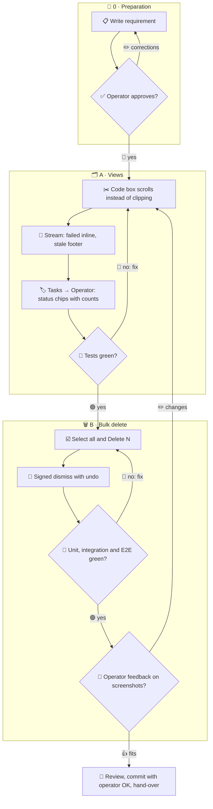

# 093 - Stale Operator Requests in Stream and Tasks

## User Story

As the operator, I want to see the expired, stale and failed requests next
to the open ones, each in the view where it matters, and delete many of them
at once, so that I clear the backlog in a minute without drowning the live
view.

## Decisions (operator-confirmed 2026-11-27; do not re-litigate)

1. **All four kinds** (operator): expired asks, expired decisions, stale
   operator rows and failed or refused rows show besides the open requests.
2. **Context split** (operator, option A): the Stream (`#stream`) shows open
   requests inline and failed or refused rows inline once, as news; expired
   and stale requests only as one collapsed footer line ("41 stale requests
   ▸" with the count per kind) that opens them in place. Tasks → Operator
   (`#tasks/operator`) gets the chips Open · Expired · Stale · Failed · All,
   each with its count. Rejected: one stale group in both views; a separate
   cleanup sheet.
3. **Bulk delete** (operator): every chip, and the opened footer, has a
   select-all checkbox and "Delete N". Delete dismisses the requests in the
   hub for every browser; agents get no message. One passkey signature, then
   the usual undo window.
4. **Nothing clipped** (operator): a request in the Stream is never cut off;
   a long command box scrolls inside instead of hiding its rest. Found
   2026-11-27: `.code-box[data-open="false"] > .code-body` capped 12 lines
   with `overflow: hidden`.

## Approach

## Acceptance Criteria

### Views

- [ ] A Stream request with a 40-line command shows every line by scrolling
      inside its box; no element of the request is hidden.
- [ ] A failed operator row appears once inline in the Stream; expired and
      stale requests appear only behind the footer line, which names the
      count per kind.
- [ ] Tasks → Operator shows the five chips with counts; each chip lists
      exactly its kind.

### Bulk delete

- [ ] Select all plus "Delete N" on the Expired chip dismisses every expired
      request after one passkey signature; they are gone in a second browser.
- [ ] Undo within the window brings them back.
- [ ] An open request is never deleted by a chip other than Open or All.

### Tests

- Unit:
  - [ ] Kind classification of a request (open, expired, stale, failed).
- Integration:
  - [ ] The signed dismiss endpoint takes a list of requests, refuses an
        unsigned call, and the undo restores them.
- E2E:
  - [ ] `tests/e2e/test_stale_requests_e2e.py`: footer line, chips and
        counts, select all, delete, undo, unclipped long command.
