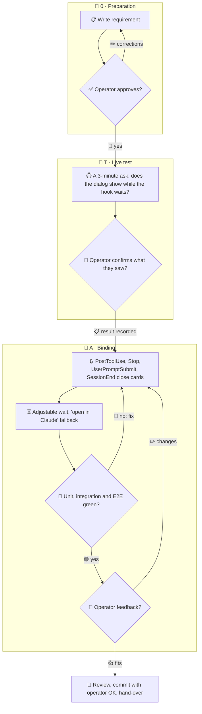

# 094 - Hub Cards Bound to Their Claude Dialog

## User Story

As the operator, I want a hub card for a Claude dialog (an ask or an
AskUserQuestion) to live exactly as long as that dialog and to close the
moment either side answers, so that I never see a card expire or go stale
while its dialog in Claude is still open.

## Decisions (operator-confirmed 2026-11-27; do not re-litigate)

1. **Cause** (found 2026-11-27): the PermissionRequest hook waits
   `HOOK_TIMEOUT=110` s (`scripts/orchestrator.sh`) for the hub; then the
   card expires while Claude's own dialog stays open as long as the operator
   takes. The operator rejected several such cards as "expired in hub".
2. **One lifecycle per dialog** (operator): the card and the dialog share
   the call key of 080. The hook keeps waiting while the dialog lives, up
   to a timeout adjustable in Settings (default 60 min, at most the hook
   timeout Claude Code allows); whichever side answers first wins.
3. **Claude's answer closes the card at once** (operator): PostToolUse (an
   allowed call, an AskUserQuestion with its answers) closes it as "answered
   in Claude"; the session's next `Stop` or `UserPromptSubmit` closes every
   still open card of that session (a denial or an interrupt in Claude);
   `SessionEnd` closes the session's cards.
4. **Timer only as fallback** (operator): a card whose hook timed out while
   its dialog may still be open shows "open in Claude: answer it there",
   never stale or expired; it closes by decision 3.
5. **Test first** (operator): before the wait grows, a live test settles
   whether Claude shows its dialog while the hook waits (the docs do not
   say). If the dialog only appears after the hook returns, the default wait
   stays at 110 s and decisions 3 and 4 still apply.
   Rejected: a longer fixed wait without the binding.

## Approach

## Acceptance Criteria

### Binding

- [ ] An ask allowed in Claude leaves the hub's open cards within 5 s of
      its PostToolUse.
- [ ] An AskUserQuestion answered in Claude closes its hub decision with
      the answers shown.
- [ ] A denial in Claude closes the session's open cards at its next `Stop`
      or `UserPromptSubmit`.
- [ ] `SessionEnd` closes every open card of the session.
- [ ] After a hook timeout the card reads "open in Claude" and carries no
      stale or expired stamp.

### Wait

- [ ] Settings holds the wait (1 to 60 min); the hook's `--timeout` and its
      settings.json timeout follow it after `make orchestrator-hook`.
- [ ] The live test result is recorded in this document.

### Tests

- Unit:
  - [ ] Card state over the lifecycle: open, answered in hub, answered in
        Claude, open in Claude.
- Integration:
  - [ ] Each closing hook event through the HTTP handler closes exactly the
        cards of its session and call key.
- E2E:
  - [ ] `tests/e2e/test_dialog_bound_cards_e2e.py`: a card closes on a
        simulated PostToolUse, Stop and SessionEnd; the "open in Claude"
        state after a timeout.
