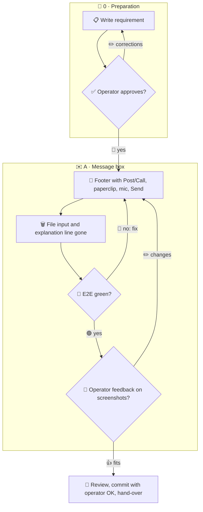

# 095 - Compact Agent Message Box

## User Story

As the operator, I want the message box to one agent to be one compact
field with everything inside it, so that I write, attach and send without a
second file picker or explanation text in the way.

## Decisions (operator-confirmed 2026-11-27; do not re-litigate)

1. **One merged field** (operator): the message dialog to one agent
   (`openAgent` in `orchestrator/templates/page-agent.js`) looks like the
   radio composer of 066: text area on top, one footer row inside the same
   frame.
2. **No second file picker** (operator): the native "Choose File" input
   goes; the paperclip of 082 attaches files.
3. **Controls in the footer** (operator): Post/Call as a small segmented
   switch on the left, paperclip, mic and the Send button on the right of
   the field's footer.
4. **No explanation line** (operator): "Post arrives at the end of the
   turn, ..." goes; the passkey and `operator_message` hint moves into the
   Send button's tooltip, the Post and Call meaning into their tooltips.

## Approach

## Acceptance Criteria

### Layout

- [ ] The agent message dialog holds no `input[type=file]` and no
      explanation paragraph.
- [ ] Post/Call, paperclip, mic and Send lie inside the field's frame in
      one footer row at 1366 and 390 px.
- [ ] Send's tooltip names the passkey signature and `operator_message`;
      Post and Call each explain their delivery in their tooltip.

### Function

- [ ] A message with a pasted screenshot arrives with its `📎` path line;
      Post and Call still choose the class.

### Tests

- Unit:
  - n/a: layout only.
- Integration:
  - n/a: no server change.
- E2E:
  - [ ] `tests/e2e/test_agent_message_box_e2e.py`: no file input, footer
        controls inside the frame, send as post and as call, screenshots
        at 1366 and 390.
