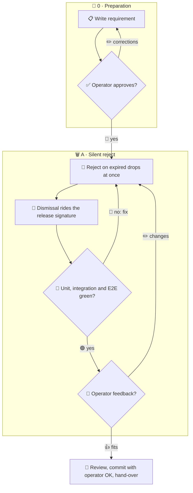

# 096 - Silent Reject of Expired Match Cards

## User Story

As the operator, I want Reject on an expired Match card to remove it at
once without a feedback dialog or a message, so that I clear expired cards
with one swipe each.

## Decisions (operator-confirmed 2026-11-27; do not re-litigate)

1. **No dialog, no message** (operator): Reject, A, ← or a left swipe on an
   expired card (080) opens no feedback box and sends no radio message to
   its agent; the card leaves the deck at once with the 086 fade. This
   replaces 080's reject-by-radio for expired cards.
2. **Gone everywhere at release** (operator): the dropped card rides along
   with the next release signature as a dismissal through the hub-wide
   dismiss of 093, so it disappears in every browser; the usual undo window
   applies. Rejected: dropping it only in this browser.
3. **Release card row**: until the release, each dropped expired card shows
   on the release card as "Drop (expired)", without feedback text; Back to
   the stack (092) brings it back.
4. **S undoes**: S right after the swipe puts the card back, as for any
   other step.

## Approach

## Acceptance Criteria

### Reject

- [ ] Reject, A, ← and a left swipe on an expired card open no sheet and
      the card leaves the deck within 300 ms.
- [ ] The release card lists it as "Drop (expired)" without feedback text.
- [ ] S right after the swipe brings the card back to the front.

### Release

- [ ] The release signs the dismissal together with the other decisions;
      afterwards the card is gone in a second browser.
- [ ] No radio message reaches the card's agent.
- [ ] Undo within the window brings the card back.

### Tests

- Unit:
  - [ ] The release plan puts a dropped expired card into the dismissals,
        not into the radio rejects.
- Integration:
  - [ ] A release with a dismissal through the HTTP handler dismisses the
        card and sends no radio call.
- E2E:
  - [ ] `tests/e2e/test_match_expired_e2e.py`: swipe left on an expired
        card, no sheet, release, gone in a second page, no radio call.
