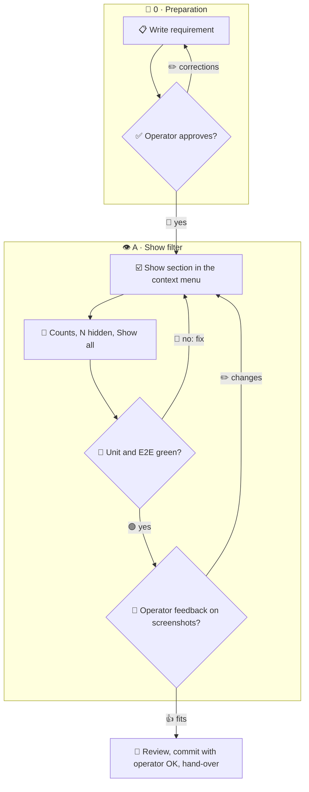

# 097 - Match Show Filter in the Right-Click Menu

## User Story

As the operator, I want to choose in Match's right-click menu which card
kinds and states the deck shows, so that I work through one kind at a time.

## Decisions (operator-confirmed 2026-11-27; do not re-litigate)

1. **Kinds and states** (operator): a right click in Match (outside code
   rows, where 078 line comments keep their own menu) opens the context
   menu with a "Show" section: checkboxes Commit, Command, Ask, Decision,
   Rule, then Expired, Stale and Greyed (running, queued, blocked), each with
   its current count, and "Show all". Rejected: kinds only; saved profiles;
   chips in the header.
2. **Per browser**: the choice is remembered in this browser and survives a
   reload.
3. **Hidden, not gone**: hidden cards stay in the hub and on the release
   card if already decided; the deck header reads "N hidden" next to the
   card count, and a click on it reopens the menu.
4. **Never an empty trap**: when every card is hidden, the empty state says
   "All N cards hidden by the Show filter" with a "Show all" button.

## Approach

## Acceptance Criteria

### Menu

- [ ] A right click on the Match deck outside code rows shows the Show
      section with eight checkboxes and their counts.
- [ ] A right click on a code row still opens its line comment (078).

### Filter

- [ ] Unticking Ask removes every Ask card from the deck and the header
      reads "N hidden"; a reload keeps it.
- [ ] With all cards hidden the empty state names the count and "Show all"
      restores every card.
- [ ] A decided card that gets hidden stays on the release card.

### Tests

- Unit:
  - [ ] The filter over kinds and states, the counts and "N hidden" (node).
- Integration:
  - n/a: no server change.
- E2E:
  - [ ] `tests/e2e/test_match_show_filter_e2e.py`: menu, untick, header
        count, reload, all hidden, Show all, code row comment still works.
